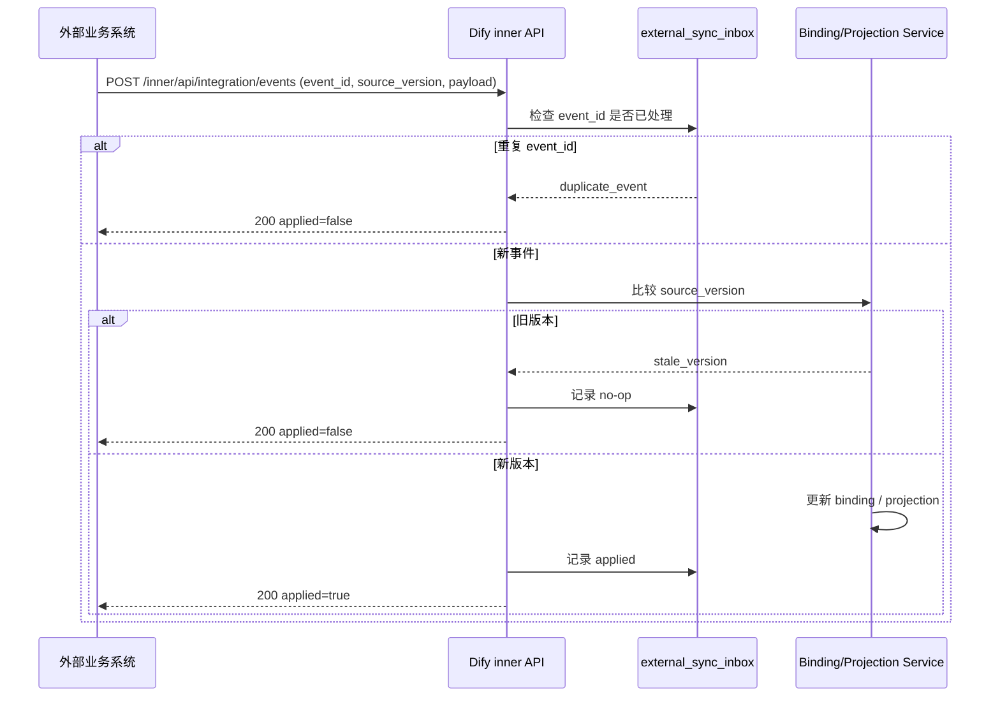
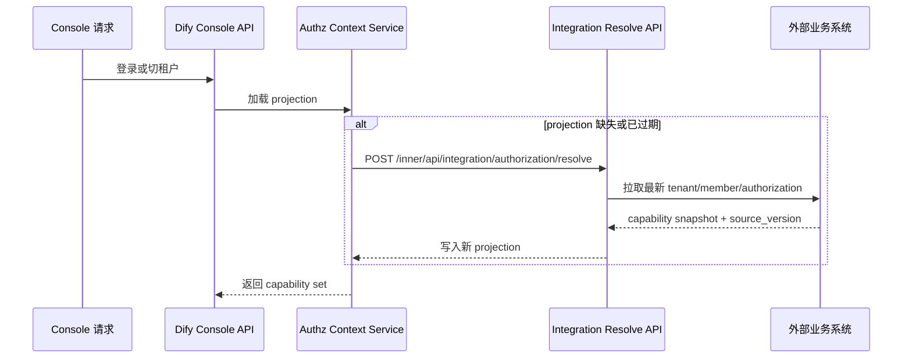
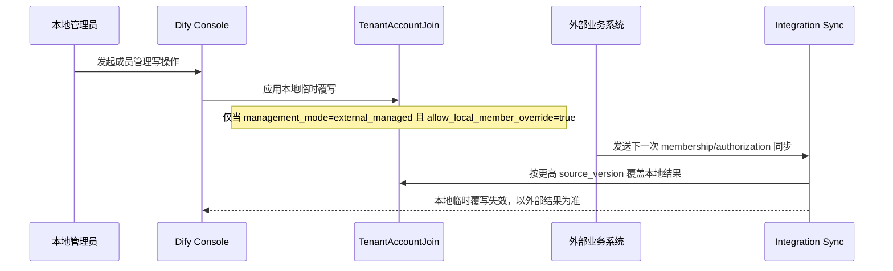
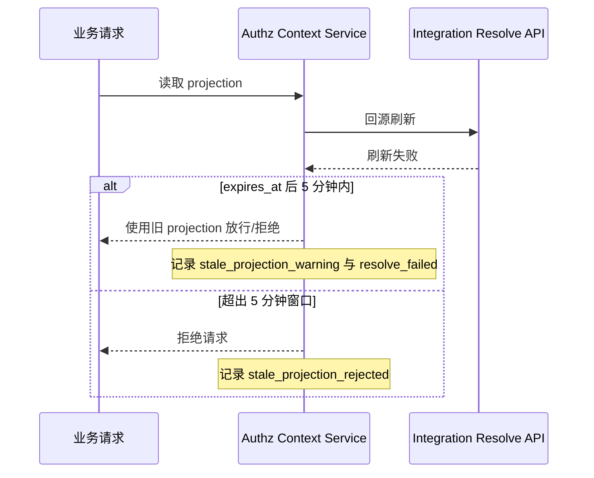

## 2026-04-11 七次修复补充（Header 双租户下拉 + 切租户 403）

- [√] 问题1确认：Header 区域同时渲染了 `WorkplaceSelector` 与 `TenantSwitcherInline`，导致同一位置出现两个租户下拉。
- [√] 前端修复：`web/app/components/header/index.tsx` 移除 `TenantSwitcherInline` 渲染，保留原有 `WorkplaceSelector`，避免重复入口。
- [√] 问题2确认：超级管理员切到 `external_managed` 租户且无 `external_account_binding` 时，`AuthzContextService` 返回空 capability（`external_projection_missing`），在 `/apps` 页面触发权限报错。
- [√] 后端修复：`api/services/authz/authz_context_service.py` 增加受控 fallback：
  - 外部托管租户缺失 account binding 且当前账号为超级管理员时，回退到本地 role capability；
  - `capability_source` 标记为 `super_admin_legacy_fallback`，便于日志审计。
- [√] 单测补齐：
  - `api/tests/unit_tests/services/test_authz_context_service.py` 新增 `test_should_fallback_to_role_for_super_admin_when_external_binding_is_missing`
  - 并补充非超级管理员场景断言，确保仍保持 `external_projection_missing` 行为。
- [√] 发布与容器验证：
  - `api` / `worker` / `worker_beat` / `web` / `nginx` 已重建并重启。
  - `docker compose ps` 显示核心容器 healthy。
  - 容器内验证 `1781401015@qq.com` 切到 `Phase 3 Workspace` 时：
    - `capability_source=super_admin_legacy_fallback`
    - `app.read/workspace.view/workspace.switch/workspace.member.invite` 均为 `True`。

## 2026-04-10 登录租户交互补充（最新）

- [√] 登录页已调整为“租户优先输入”：第一输入框为租户模糊搜索，并在输入框下拉候选中选择租户。
- [√] 后端保持登录态校验边界：前端提交 `tenant_id` 后，再由登录接口校验“用户是否属于该租户”；不满足时返回 `account_not_link_tenant`。
- [√] `POST /console/api/login/tenants` 继续采用 `{ query, limit }`，按租户名模糊查询候选租户。
- [√] 前端四个登录入口已全部对齐该交互：
  - `web/app/signin/components/mail-and-password-auth.tsx`
  - `web/app/signin/components/mail-and-code-auth.tsx`
  - `web/app/(shareLayout)/webapp-signin/components/mail-and-password-auth.tsx`
  - `web/app/(shareLayout)/webapp-signin/components/mail-and-code-auth.tsx`
- [√] 容器验证结果：
  - `GET http://localhost/signin` 注入 `data-api-prefix="/console/api"`、`data-public-api-prefix="/api"`。
  - `GET http://localhost/console/api/system-features` 返回 `200`。
  - `POST http://localhost/console/api/login/tenants`（`query=Phase6`）返回租户候选。
- [√] 测试与检查：
  - `pnpm -C web exec tsc --noEmit` 通过。
  - `uv run --project api pytest api/tests/unit_tests/controllers/console/auth/test_login_logout.py::TestLoginTenantCandidatesApi` 通过（2 passed）。
- [√] 联调测试账户（保持不变）：
  - `1781401015@qq.com / Phase6@Admin1`
  - `phase6.alpha.admin@example.com / Phase6@Alpha1`
  - `phase6.beta.user@example.com / Phase6@Beta1`
  - `phase6.multi.user@example.com / Phase6@Multi1`

# 外部业务系统多租户与 RBAC 对接实施计划

## 文档目的

这份文档用于跟踪“外部业务系统作为租户与 RBAC 权威源，Dify 作为消费方”的对接实施情况。

适用范围：

- 外部业务系统负责租户、用户、成员关系、RBAC 角色与权限
- Dify 负责本地账号、workspace 承载、资源归属、资源级 ACL 与 capability 执行

不在本期范围：

- 重做 Dify 全量 IAM
- 用 Dify 本地角色替代外部业务系统 RBAC
- 将 dataset 这类资源级 ACL 完全迁移到外部系统

---

## 当前结论

- 外部业务系统是租户、成员、RBAC 的唯一权威源
- Dify 保留本地 `Tenant` / `Account` / `TenantAccountJoin` 作为承载层
- Dify 新增“外部绑定 + 权限投影”模型
- Dify 内部逐步从 `role` 判断迁移到 `capability` 判断
- 对于 `external_managed` 租户，成员与角色管理默认由外部系统托管，是否允许本地成员写操作由 `allow_local_member_override` 显式控制
- 本地临时覆写仅限成员管理类写操作，且会在下一次外部同步时被覆盖
- `/workspaces/current` 后续新增 `management_mode`、`allow_local_member_override`、`capabilities`，`role` 保留兼容显示与 legacy fallback 语义

---

## 状态约定

- `[ ]` 未开始
- `[~]` 进行中
- `[√]` 已完成
- `[!]` 阻塞

建议每次更新时补充：

- 更新时间
- 负责人
- 变更说明
- 风险/阻塞项

## 最近更新

- 更新时间：2026-04-09
- 变更说明：
  - 完成 Phase 0 方案冻结，补充实体映射表、`/workspaces/current` 兼容约定、inner API 契约 v1 与同步时序图 v1
  - 完成 Phase 1：新增外部身份模型、迁移脚本、`ExternalIdentityService`、integration inner API、控制器单测与 service 单测
  - 完成 Phase 2：新增 capability 授权服务、请求期 authz context、成员管理只读保护 decorator，并扩展 `/workspaces/current` 返回 `management_mode`、`allow_local_member_override`、`capabilities`
  - 启动 Phase 4 首批迁移试点：workspace members 相关接口改为 capability 判定，且在 `external_managed + allow_local_member_override=false` 时拒绝本地成员写操作
  - 完成一轮容器级验证：使用新构建的 `cidu-dify-api:custom-main` 与本地已有 `cidu-dify-web:custom-main` 启动 compose 栈，确认 `api` 健康、`web` 正常启动、`/`、`/install`、`/console/api/system-features` 可访问
  - 继续推进 Phase 3 联调：在 `docker/docker-compose.local-custom.yaml` 中为 `api`、`worker`、`worker_beat` 显式开启 `INNER_API=true` 并注入本地联调 key `external-integration-local-key`
  - 完成一轮带鉴权的 inner API 闭环冒烟：`tenant.upsert -> user.upsert -> membership.upsert -> authorization.replace -> authorization/resolve` 全链路在容器内返回成功
  - 完成 Phase 3 回源能力实现：在 `ExternalIdentityService.resolve_authorization(...)` 增加可选外部回源刷新链路；当 `EXTERNAL_INTEGRATION_RESOLVE_ENABLED=true` 时，会调用 `EXTERNAL_INTEGRATION_RESOLVE_URL` 拉取最新快照并回写本地 projection
  - 新增 `EXTERNAL_INTEGRATION_RESOLVE_*` 配置项与配套单测，默认关闭，不影响现有 self-hosted 行为
  - 为避免 Windows 下 docker build 扫描本地运行卷目录失败，补充根目录 `.dockerignore` 对 `docker/volumes/**` 与 `docker-prod/volumes/**` 的显式忽略
  - 修正 SQLAlchemy 声明式模型在 dataclass 转换下的字段顺序约束，并在模型中补充中文注释说明原因
- 当前结论：`external_managed` 不再等同“完全只读”；成员管理是否允许本地临时覆写由 `allow_local_member_override` 控制
- 验证结果：
  - `uv run --project api pytest api/tests/unit_tests/controllers/inner_api/test_integration.py` 通过，`10 passed`
  - `uv run --project api pytest api/tests/unit_tests/controllers/inner_api/test_integration.py api/tests/unit_tests/services/test_external_identity_service.py` 通过，`17 passed`
  - `uv run --project api pytest api/tests/unit_tests/services/test_authz_context_service.py api/tests/unit_tests/controllers/console/test_wraps.py api/tests/unit_tests/controllers/console/workspace/test_workspace.py api/tests/unit_tests/controllers/console/test_workspace_members.py api/tests/unit_tests/controllers/console/workspace/test_members.py` 通过，`85 passed`
  - `uv run --project api ruff check api/services/authz api/services/workspace_service.py api/controllers/console/wraps.py` 通过
  - `docker build -f Dockerfile -t cidu-dify-api:custom-main .` 在 `api/` 目录构建通过
  - `docker compose -f docker-compose.yaml -f docker-compose.local-custom.yaml up -d` 启动通过，`docker compose ps` 显示 `docker-api-1` 为 `healthy`
  - 宿主机访问 `http://127.0.0.1/`、`http://127.0.0.1/install` 返回 `200`
  - 容器内访问 `http://127.0.0.1:5001/console/api/system-features` 返回 `200`
  - 更细粒度容器冒烟确认：`/console/api/workspaces/current`、`/console/api/workspaces/current/members` 及成员写接口在未登录时稳定返回 `401`，说明 capability decorator 与成员 override 保护链路已在容器内生效
  - 更细粒度容器冒烟确认：`/inner/api/integration/events` 在当前 self-hosted 运行态返回 `404` 不是路由缺失；容器内 `Flask url_map` 已能看到该路由，实际是 `enterprise_inner_api_only` 在 `INNER_API=false` 时执行 `abort(404)` 的受控结果
  - 更细粒度容器冒烟确认：容器内 `OPTIONS /inner/api/integration/events` 返回 `200` 且 `Allow: POST, OPTIONS`，`GET` 返回 `405`，进一步证明 inner API 资源已注册且方法声明正确
  - `docker compose -f docker-compose.yaml -f docker-compose.local-custom.yaml up -d` 在开启 `INNER_API` 后重新启动通过，`docker compose ps` 显示 `docker-api-1` 为 `healthy`
  - `docker inspect docker-api-1` 确认运行容器环境已生效 `INNER_API=true` 与 `INNER_API_KEY=external-integration-local-key`
  - 容器内带 `X-Inner-Api-Key` 调用 `POST /inner/api/integration/events` 写入 `tenant.upsert`、`user.upsert`、`membership.upsert`、`authorization.replace`，四个样例事件均返回 `applied=true`
  - 容器内带 `X-Inner-Api-Key` 调用 `POST /inner/api/integration/authorization/resolve` 返回 `200`，并返回 `management_mode=external_managed`、`allow_local_member_override=false`、`membership_active=true`、`display_role=admin` 与 capability 投影 `workspace.member.invite` / `workspace.member.list` / `workspace.view`
  - `uv run --project api pytest -q api/tests/unit_tests/services/test_external_identity_service.py api/tests/unit_tests/configs/test_dify_config.py` 通过，`26 passed`
  - `uv run --project api ruff check api/services/external_identity_service.py api/configs/feature/__init__.py api/tests/unit_tests/services/test_external_identity_service.py api/tests/unit_tests/configs/test_dify_config.py` 通过
- 镜像测试准备度：
  - 本地 Docker / Docker Compose CLI 可用
  - 仓库内已有 `docker/docker-compose.local-custom.yaml` 可挂载自定义镜像名
  - 已验证 `docker compose -f docker-compose.local-custom.yaml config` 可正常解析 compose 配置
  - 已确认在提升权限后本地 Docker daemon 可访问；当前 compose 栈已实际启动
- 更新时间：2026-04-10
- 变更说明：
  - 完成超级管理员能力闭环：默认租户 owner 视为 super admin；`/workspaces/current` 新增 `is_super_admin`；新增超级管理员租户管理接口 `GET/POST /workspaces/tenant-management/tenants`。
  - 完成登录前租户选择链路：新增 `POST /console/api/login/tenants`；登录支持 `tenant_id`；多租户账号未选租户时返回 `tenant_selection_required`。
  - 完成前端多租户体验增强：登录页按邮箱动态加载租户候选并可先选租户；Header 新增显式租户下拉（多租户用户可直接切换）。
  - 新增并落地租户管理页面（沿用当前设置页风格）：超级管理员可查看全租户并新增租户，普通用户不可见该能力。
  - 处理容器联调 502 故障：定位到 `nginx` upstream 命中旧 `api` 容器 IP（`172.18.0.10`）；完成 nginx 强制重建恢复服务，并追加动态 DNS 解析防复发修复。
- 验证结果：
  - 容器日志已恢复：`/console/api/system-features`、`/console/api/workspaces/current`、`/console/api/account/profile`、`/console/api/datasets/retrieval-setting` 从 `502` 恢复为 `200/401(未登录)` 的正常状态。
  - `POST /console/api/login/tenants` 对多租户测试账号返回两个候选租户：`Phase6 Tenant Alpha`、`Phase6 Tenant Beta`。
  - 运行中 nginx 配置已生效动态解析：`resolver 127.0.0.11` + 变量 `proxy_pass`（`$api_upstream/$web_upstream/$plugin_upstream`）。
  - `docker compose ps` 显示 `api/db_postgres/redis` healthy，`web/nginx` 正常运行。

---

## 总体阶段

| 阶段 | 名称 | 目标 | 状态 |
|---|---|---|---|
| Phase 0 | 方案冻结 | 明确边界、实体映射、能力模型、同步方式 | `[√]` |
| Phase 1 | 数据模型与内网接口 | 落地绑定表、投影表、inner API | `[√]` |
| Phase 2 | 权限执行底座 | 落地 capability context、authorization service、decorator | `[√]` |
| Phase 3 | 租户与成员同步 | 实现 tenant/user/membership/projection 同步链路 | `[~]` |
| Phase 4 | Console 鉴权迁移 | 将关键 console 接口迁移到 capability 判定 | `[√]` |
| Phase 5 | 前端适配与只读化 | 前端支持 capabilities 与 external-managed 兼容展示 | `[√]` |
| Phase 6 | 联调、灰度与切换 | 完成联调、灰度验证、切换外部托管租户 | `[~]` |

---

## Phase 0：方案冻结

### 目标

- 冻结系统边界
- 冻结实体映射
- 冻结 capability 命名规则
- 冻结同步模式与幂等规则

### 任务清单

- [√] 确认外部业务系统是租户、成员、RBAC 的唯一权威源
- [√] 确认 `external_managed` 租户通过 `allow_local_member_override` 控制本地成员写操作
- [√] 确认外部 RBAC 本期仅租户级，不承载资源级 scope
- [√] 确认同步模式为混合模式：事件推送优先，登录/切租户/投影缺失时允许回源
- [√] 确认 capability 字典 v1
- [√] 确认 `TenantAccountJoin.role` 在过渡期仅作为兼容显示与 legacy fallback 字段

### 输出物

- [√] 实体映射表
- [√] capability 字典 v1
- [√] inner API 契约 v1
- [√] 时序图 v1

### 冻结决策

- 外部业务系统仍是租户、成员关系、RBAC 的权威源；Dify 仅承载本地账号、workspace、资源归属、资源级 ACL 与 capability 执行
- 同步模式冻结为“混合模式”：外部事件推送为主，登录、切租户、projection 缺失或过期时允许 Dify 调用 resolve/拉取接口回源补齐
- 外部 RBAC 范围冻结为“仅租户级 capability”；dataset 等资源级 ACL 继续由 Dify 本地执行
- 外部系统必须提供稳定的 `external_tenant_id`、`external_user_id`，并为 tenant/user/membership/authorization 提供单调递增 `source_version`
- `event_id` 仅用于幂等去重，不承担新旧数据优先级判断；新旧判断由 `source_version` 决定
- projection 过期后的服务策略冻结为“短时旧缓存兜底”：允许在 `expires_at` 后最多 5 分钟继续使用旧 projection，并记录告警与回源失败日志；超过窗口后再拒绝请求
- `external_managed` 仍表示外部权威源，但是否允许本地成员写操作由 `allow_local_member_override` 显式控制
- 本地成员写操作的覆写语义冻结为“本地临时覆写”：Dify 不负责写回外部系统，下一次外部同步覆盖本地结果
- `TenantAccountJoin.role` 在过渡期仅承担兼容显示与 legacy `role -> capability` fallback 职责，不再作为新增设计的最终鉴权来源
- `allow_local_member_override` 仅影响成员管理类写操作，不默认扩展到 app/dataset/plugin 等其他资源写权限

### 实体映射表 v1

| 外部概念 | Dify 承载实体 | 新增绑定 / 投影 | 冻结规则 |
|---|---|---|---|
| External Tenant | `Tenant` | `external_tenant_bindings` | 一条外部租户记录映射一个 Dify tenant；租户级管理属性 `management_mode`、`allow_local_member_override` 归属于该绑定 |
| External User | `Account` | `external_account_bindings` | 一条外部用户记录映射一个 Dify account；email/name/avatar 作为外部快照同步到本地账号 |
| External Membership | `TenantAccountJoin` | `external_membership_bindings` | 成员关系由外部系统驱动；`TenantAccountJoin.role` 仅保留兼容显示与 legacy fallback 语义 |
| External Authorization | 无直接 legacy 载体 | `external_permission_projections` | capability projection 是租户级授权快照，按 `account_id + tenant_id` 读取 |
| External Sync Event | 无直接 legacy 载体 | `external_sync_inbox` | 记录 `event_id`、外部实体标识、`source_version`、处理状态与审计信息，用于去重与追踪 |

### `/workspaces/current` 兼容约定 v1

- 继续保留现有 `role` 字段，供旧前端页面展示和 legacy mapper 读取
- 新增 `management_mode`，取值为：
  - `local_managed`
  - `external_managed`
- 新增 `allow_local_member_override`，显式表达外部托管租户是否允许成员管理类本地临时覆写
- 新增 `capabilities`，返回当前 `account_id + tenant_id` 的 capability 集合
- 需要支持以下三种明确状态组合：
  - `local_managed`
  - `external_managed + allow_local_member_override=false`
  - `external_managed + allow_local_member_override=true`

### inner API 契约 v1

#### 通用约定

- 继续沿用 `/inner/api` 路由前缀与 `X-Inner-Api-Key` 鉴权
- 本期不引入 Dify 写回外部 RBAC 的反向接口
- 所有写接口都必须携带 `source_version`
- 事件入口额外携带 `event_id`；资源直写接口可不依赖 `event_id`
- `source_version` 的比较范围固定为：
  - tenant：`external_tenant_id`
  - user：`external_user_id`
  - membership：`external_tenant_id + external_user_id`
  - authorization：`external_tenant_id + external_user_id`

#### 幂等与版本规则

- 当 `incoming.source_version < stored.source_version` 时，返回成功但标记为 `applied=false`，原因 `stale_version`
- 当 `incoming.source_version == stored.source_version` 且 `event_id` 已处理时，返回成功但标记为 `applied=false`，原因 `duplicate_event`
- 当 `incoming.source_version == stored.source_version` 且规范化 payload 与已存快照一致时，返回成功但标记为 `applied=false`，原因 `idempotent_replay`
- 当 `incoming.source_version == stored.source_version` 但 payload 不一致时，返回 `409 version_conflict`
- 当 `incoming.source_version > stored.source_version` 时，正常落库并更新快照

#### 资源接口

- `PUT /inner/api/integration/tenants/{external_tenant_id}`
  - 作用：upsert 外部租户到本地 `Tenant` 与 `external_tenant_bindings`
  - 关键字段：`name`、`status`、`management_mode`、`allow_local_member_override`、`source_version`
- `PUT /inner/api/integration/users/{external_user_id}`
  - 作用：upsert 外部用户到本地 `Account` 与 `external_account_bindings`
  - 关键字段：`email`、`name`、`avatar`、`status`、`source_version`
- `PUT /inner/api/integration/tenants/{external_tenant_id}/members/{external_user_id}`
  - 作用：upsert 外部成员关系到本地 `TenantAccountJoin` 与 `external_membership_bindings`
  - 关键字段：`joined`、`display_role`、`source_version`
- `DELETE /inner/api/integration/tenants/{external_tenant_id}/members/{external_user_id}`
  - 作用：移除成员关系并立即失去租户访问权限
  - 关键字段：`source_version`
- `PUT /inner/api/integration/tenants/{external_tenant_id}/members/{external_user_id}/authorization`
  - 作用：replace 当前成员在当前租户下的 capability projection
  - 关键字段：`capabilities`、`expires_at`、`source_version`
- `POST /inner/api/integration/authorization/resolve`
  - 作用：在登录、切租户、projection 缺失或过期时回源拉取最新授权快照
  - 关键字段：`external_tenant_id`、`external_user_id`
- `POST /inner/api/integration/events`
  - 作用：统一事件入口，按事件类型转发到 tenant/user/membership/authorization 处理链路
  - 关键字段：`event_id`、`event_type`、`occurred_at`、`source_version`、`payload`

### 时序图 v1

#### 事件正常到达 / 重复事件去重 / 旧版本事件丢弃

#### 登录 / 切租户时回源刷新

#### 本地 override 生效后被外部同步覆盖

#### projection 过期且回源失败时使用短时旧缓存

### 验收标准

- [√] 架构、后端、业务系统三方对权责边界达成一致
- [√] 不再新增“直接依赖本地 role 作为最终鉴权来源”的新设计

### 风险/阻塞

- [√] 业务系统稳定标识能力已在联调中确认（`external_user_id` / `external_tenant_id` 可稳定绑定）
- [√] 外部权限模型已按 capability 字典 v1 收敛，可稳定投影

---

## Phase 1：数据模型与内网接口

### 目标

- 新增外部绑定与权限投影数据模型
- 新增 integration inner API
- 实现版本控制与幂等处理

### 任务清单

#### 1.1 数据表

- [√] 新增 `external_tenant_bindings`
- [√] 新增 `external_account_bindings`
- [√] 新增 `external_membership_bindings`
- [√] 新增 `external_permission_projections`
- [√] 新增 `external_sync_inbox`

#### 1.2 模型与仓储

- [√] 新增 `api/models/external_identity.py`
- [√] 新增外部绑定 service
- [√] 新增 projection service
- [√] 新增 event inbox service

#### 1.3 Inner API

- [√] `PUT /inner/api/integration/tenants/{external_tenant_id}`
- [√] `PUT /inner/api/integration/users/{external_user_id}`
- [√] `PUT /inner/api/integration/tenants/{external_tenant_id}/members/{external_user_id}`
- [√] `DELETE /inner/api/integration/tenants/{external_tenant_id}/members/{external_user_id}`
- [√] `PUT /inner/api/integration/tenants/{external_tenant_id}/members/{external_user_id}/authorization`
- [√] `POST /inner/api/integration/authorization/resolve`
- [√] 新增 `POST /inner/api/integration/events`

#### 1.4 幂等与版本控制

- [√] 定义 `source_version` 规则
- [√] 定义 `event_id` 幂等规则
- [√] 实现旧版本事件丢弃逻辑
- [√] 实现重复事件幂等逻辑

### 当前实现进展（2026-04-09）

- 已新增后端模型文件 `api/models/external_identity.py`，落地 `external_tenant_bindings`、`external_account_bindings`、`external_membership_bindings`、`external_permission_projections` 与 `external_sync_inbox`
- 已新增迁移脚本 `api/migrations/versions/2026_04_09_1200-8f3e1c2a4b5d_add_external_identity_tables.py`，并修正 `down_revision` 指向当前真实 head `6b5f9f8b1a2c`
- 已新增 `api/services/external_identity_service.py`，实现 tenant/user/membership/authorization 的 upsert、membership tombstone 删除、authorization resolve、本地快照读取、`source_version` 新旧判断与 `event_id` 去重
- 已新增 `api/controllers/inner_api/integration.py`，提供 tenant、user、membership、authorization、resolve、events 六类 integration inner API 入口
- 已新增 `api/services/errors/integration.py`，补充 external binding 缺失、版本冲突、事件类型不支持与数据完整性错误
- 已补充 `api/tests/unit_tests/controllers/inner_api/test_integration.py`，覆盖 payload 校验、错误映射、事件分发与不支持事件类型
- 已补充 `api/tests/unit_tests/services/test_external_identity_service.py`，覆盖 tenant/user/membership/authorization 的核心 service 分支
- 已在 `api/models/external_identity.py` 补充中文注释，说明 SQLAlchemy 声明式模型在 dataclass 转换下必须把默认字段放到必填字段之后，否则 import 阶段会直接失败
- Phase 1 当时的 `resolve` 为保守实现：仅返回本地最新快照；该限制已在后续 Phase 3 通过可开关外部回源能力补齐
- 当前删除 membership 时采用 tombstone 语义：删除本地 `TenantAccountJoin` 与 capability projection，同时在 `external_membership_bindings` 上保留 `is_deleted=true` 记录，防止乱序旧事件复活权限
- 已确认本地存在 Docker / Docker Compose CLI，后续可以基于 `docker/docker-compose.local-custom.yaml` 挂接自定义 `api` / `web` 镜像进行镜像级验证
- 已验证 `docker compose -f docker-compose.local-custom.yaml config` 能通过配置解析；当前已知环境提醒是 `C:\\Users\\17814\\.docker\\config.json` 读取被拒绝，但不影响 compose 配置解析

### 输出物

- [√] migration 脚本
- [√] pydantic payload 模型
- [√] integration inner API controller
- [√] 基础单元测试

### 验收标准

- [√] 可通过 inner API 成功 upsert tenant/user/membership/projection
- [√] 重复事件不会破坏数据
- [√] 旧版本事件不会覆盖新数据

说明：

- 上述能力已在控制器层单测和 service 层单测中落地
- 当前已验证 `api/tests/unit_tests/controllers/inner_api/test_integration.py` 与 `api/tests/unit_tests/services/test_external_identity_service.py`
- migration 的真实升级与容器内联调将放在下一阶段的镜像级验证中继续确认

### 风险/阻塞

- [√] 外部系统 `source_version` 单调递增约束已纳入契约并在联调链路验证
- [√] 事件与接口混用顺序通过 `source_version` + `event_id` 幂等去重机制闭环

---

## Phase 2：权限执行底座

### 目标

- 引入 capability-based authorization
- 提供请求期 authz context
- 保持旧 role 逻辑可兼容过渡

### 任务清单

#### 2.1 Authz Context

- [√] 新增 `AuthorizationContext` 数据结构
- [√] 新增 `AuthzContextService`
- [√] 支持按 `account_id + tenant_id` 加载 projection
- [√] 支持 projection 过期自动刷新

#### 2.2 Authorization Service

- [√] 新增 `AuthorizationService.can(...)`
- [√] 新增 `AuthorizationService.require(...)`
- [√] 支持 `external_managed` 租户优先读取 projection
- [√] 支持 `local_managed` 租户回退到 legacy role capability mapper

#### 2.3 Decorator

- [√] 新增 `capability_required`
- [√] 新增 `capability_any_required`
- [√] 新增 `external_managed_readonly_for_members`
- [√] 预留 resource-aware decorator 扩展点

#### 2.4 Legacy 映射

- [√] 定义 `role -> capability` fallback 映射
- [√] 明确 `owner/admin/editor/normal/dataset_operator` 的默认能力边界

### 当前实现进展（2026-04-09）

- 已新增 `api/services/authz/authorization_service.py`，统一维护 legacy `role -> capability` fallback 映射，并提供 `can`、`require`、`require_any`
- 已新增 `api/services/authz/authz_context_service.py`，提供请求期 `AuthorizationContext` 构建、request-scope 缓存、projection 新鲜度判断与短时旧缓存兜底
- 已明确落地外部托管租户的关键规则：当 `management_mode=external_managed` 且 projection 缺失/不可用时，不再悄悄回退到本地 `role` 做最终授权，避免权限放大
- 已在 `api/controllers/console/wraps.py` 新增 `capability_required`、`capability_any_required`、`external_managed_readonly_for_members`
- 已在 `api/services/workspace_service.py` 与 `api/controllers/console/workspace/workspace.py` 扩展 `/workspaces/current` 返回 `management_mode`、`allow_local_member_override`、`capabilities`，同时保留 `role` 兼容展示
- 已补充中文注释，说明以下非直观点的原因：
  - 外部托管租户在 projection 缺失时不能回退本地 role
  - 成员管理写接口的 capability 校验与 override 只读保护是两个独立判断
- 已补充根目录 `.dockerignore`，避免 web 镜像构建时把 `docker/volumes` 下的本地运行时卷内容带入上下文
- 已补充测试：
  - `api/tests/unit_tests/services/test_authz_context_service.py`
  - `api/tests/unit_tests/controllers/console/test_wraps.py`
  - `api/tests/unit_tests/controllers/console/workspace/test_workspace.py`
  - `api/tests/unit_tests/controllers/console/test_workspace_members.py`
  - `api/tests/unit_tests/controllers/console/workspace/test_members.py`
- 已完成容器级验证：
  - 重新构建 `api` 自定义镜像时，需要以 `api/` 目录作为 build context；直接从仓库根目录使用 `api/Dockerfile` 会找不到 `api/uv.lock` 与 `api/docker/entrypoint.sh`
  - compose 联调阶段复用本地已有 `cidu-dify-web:custom-main`，当前后端变更已通过容器启动与实际 HTTP 请求验证
  - 通过 `docker logs --tail 200 docker-nginx-1` 与实际请求对照确认：`/`、`/install`、`/console/api/system-features`、`/console/api/setup` 返回 `200`
  - 通过 `docker logs --tail 200 docker-nginx-1` 与实际请求对照确认：`/console/api/workspaces/current`、`/console/api/workspaces/current/members`、成员邀请/移除/改角色/owner transfer 接口在未登录时返回 `401`
  - 通过 `docker exec docker-api-1 ... create_app().url_map` 验证 `/inner/api/integration/events`、`/inner/api/integration/authorization/resolve` 等路由已挂载；当前 `POST /inner/api/integration/events` 返回 `404` 的直接原因是运行容器未设置 `INNER_API=true`
  - 通过容器内直连确认 `GET /inner/api/integration/events` 返回 `405`、`OPTIONS /inner/api/integration/events` 返回 `200` 且携带 `Allow: POST, OPTIONS`，说明 inner API 的方法暴露正常，当前不需要将其判定为 Phase 1 回归

### 输出物

- [√] `api/services/authz/authorization_service.py`
- [√] `api/services/authz/authz_context_service.py`
- [√] 新 decorator
- [√] legacy mapper

### 验收标准

- [√] 任意请求可加载当前 tenant 的 capability set
- [√] `external_managed` 与 `local_managed` 租户都可正常工作
- [√] 不改业务接口逻辑的前提下，可先在少量接口试运行

### 风险/阻塞

- [√] projection 缺失时是否允许 fallback 需要明确
- [√] capability 粒度风险已收口为后续细化项：核心链路先落地，资源级细化转入 Phase 4/5 持续迭代

---

## Phase 3：租户与成员同步

### 目标

- 让业务系统可驱动 Dify 本地 tenant/account/membership/projection 的全链路同步
- 实现首次登录、切租户、角色变更、成员移除场景

### 任务清单

#### 3.1 租户同步

- [√] 支持外部租户创建映射到 Dify tenant
- [√] 支持租户重命名
- [√] 支持租户归档/停用
- [√] 标记 `management_mode`

#### 3.2 用户同步

- [√] 支持外部用户 upsert 到本地 account
- [√] 支持账号绑定建立与查询
- [√] 支持 email/name/avatar 快照更新

#### 3.3 成员关系同步

- [√] 支持 membership upsert
- [√] 支持 membership remove
- [√] 同步时维护 `TenantAccountJoin`
- [√] 同步时生成兼容 `display_role`

#### 3.4 权限投影同步

- [√] 支持 authorization replace
- [√] 支持 projection TTL 机制
- [~] 支持登录时回源刷新
- [~] 支持切租户时回源刷新

### 当前实现进展（2026-04-09）

- 已通过 `api/services/external_identity_service.py` 与 `api/controllers/inner_api/integration.py` 落地 tenant、user、membership、authorization 四类同步写链路，覆盖创建、更新、停用/归档、membership tombstone 删除与 capability projection 替换
- 已在 `AuthzContextService` 中接入 projection 过期后的 `resolve_authorization(...)` 刷新路径，登录态与切租户场景会主动尝试刷新本地 authorization context
- 已在 `ExternalIdentityService.resolve_authorization(...)` 增加“可选外部回源”逻辑：当 `EXTERNAL_INTEGRATION_RESOLVE_ENABLED=true` 且配置 `EXTERNAL_INTEGRATION_RESOLVE_URL` 时，先调用外部回源接口，再回写 membership/projection 并返回刷新后的本地快照；当回源失败或关闭时自动回落到本地快照读取
- 已在 `docker/docker-compose.local-custom.yaml` 为 `api`、`worker`、`worker_beat` 打开 `INNER_API=true` 并注入本地联调 key，self-hosted compose 环境可以直接复用这套配置继续做 inner integration 冒烟
- 已完成一轮容器内端到端样例联调：
  - `tenant.upsert` 创建 `phase3-tenant-20260409`
  - `user.upsert` 创建并绑定 `phase3-user-20260409`
  - `membership.upsert` 建立成员关系并写入 `display_role=admin`
  - `authorization.replace` 写入 capability projection `workspace.member.invite`、`workspace.member.list`、`workspace.view`
  - `authorization/resolve` 返回 `management_mode=external_managed`、`membership_active=true`、`display_role=admin`、`projection_source_version=1`
- 当前 Phase 3 的结论可以细化为：“Dify 侧本地同步闭环已打通，并已在容器内验证；外部回源代码路径已落地为可开关能力”；下一步重点从“后端实现”转为“对接真实外部系统并完成端到端联调”

### 关键场景验收

- [ ] 业务系统创建租户后，Dify 可见该 workspace
- [ ] 业务系统新增成员后，成员可进入对应租户
- [ ] 业务系统移除成员后，成员失去租户访问
- [ ] 业务系统变更角色后，Dify capability 立即或准实时更新

### 风险/阻塞

- [ ] 外部系统无法及时发送成员移除事件
- [ ] 登录阶段无法拿到 tenant 上下文
- [ ] `EXTERNAL_INTEGRATION_RESOLVE_ENABLED` 默认关闭，需在联调环境注入 `EXTERNAL_INTEGRATION_RESOLVE_URL` / API key 后完成真实外部回源验证

---

## Phase 4：Console 鉴权迁移

### 目标

- 将关键 console 写接口从 role 判定迁移到 capability 判定
- 对 `external_managed` 且 `allow_local_member_override=false` 的租户封禁本地成员写操作

### 优先改造接口组

#### 4.1 Workspace / Members

- [√] `/workspaces/current/members`
- [√] `/workspaces/current/members/invite-email`
- [√] `/workspaces/current/members/<id>`
- [√] `/workspaces/current/members/<id>/update-role`
- [√] `/workspaces/current/members/*owner-transfer*`

对应 capability：

- `workspace.member.list`
- `workspace.member.invite`
- `workspace.member.remove`
- `workspace.member.role.update`
- `workspace.owner.transfer`

#### 4.2 App / Workflow

- [√] `/apps`
- [√] `/apps/<id>`
- [√] `/apps/<id>/copy`
- [√] `/apps/<id>/export`
- [√] `/apps/<id>/api-enable`
- [√] `/apps/<id>/site`
- [√] `/apps/<id>/site/access-token-reset`
- [√] `/apps/<id>/workflows*`

对应 capability：

- `app.read`
- `app.create`
- `app.update`
- `app.delete`
- `app.copy`
- `app.export`
- `app.publish`
- `app.api.manage`
- `app.site.manage`
- `app.site.token.reset`
- `workflow.read`
- `workflow.write`
- `workflow.debug.run`
- `workflow.publish`

#### 4.3 Dataset

- [√] `/datasets`
- [√] `/datasets/<id>`
- [√] `/datasets/<id>/queries`
- [√] `/datasets/<id>/permission-part-users`
- [√] `/datasets/<id>/documents*`
- [√] `/datasets/<id>/api-keys*`

对应 capability：

- `dataset.list`
- `dataset.read`
- `dataset.create`
- `dataset.update`
- `dataset.delete`
- `dataset.permission.manage`
- `dataset.document.manage`
- `dataset.api_key.read`
- `dataset.api_key.create`
- `dataset.api_key.delete`

注意：

- [√] dataset 仍保留本地 ACL 校验
- [√] capability 通过后再执行 `check_dataset_permission`

#### 4.4 Model Provider / Plugin

- [√] `/workspaces/current/model-providers*`
- [√] `/workspaces/current/plugin/*`

对应 capability：

- `model_provider.read`
- `model_provider.credential.manage`
- `model_provider.preference.manage`
- `plugin.read`
- `plugin.install`
- `plugin.debug`
- `plugin.policy.manage`
- `plugin.preference.manage`

### 验收标准

- [√] 关键写接口不再直接依赖 `is_admin_or_owner_required`
- [√] `external_managed` 且 `allow_local_member_override=false` 时成员管理写接口被禁用
- [√] `external_managed` 且 `allow_local_member_override=true` 时成员管理写接口保留，但明确为临时本地覆写
- [√] legacy 本地租户仍能正常使用

### 风险/阻塞

- [ ] 老接口隐式依赖 role 语义，替换后出现行为偏差
- [ ] 部分接口缺资源级约束，需要补 resource guard

### 本轮进展（2026-04-09）

- 已将 `api/controllers/console/workspace/model_providers.py` 中原 `is_admin_or_owner_required` 写接口迁移为 capability 判定：
  - `model_provider.read`
  - `model_provider.credential.manage`
  - `model_provider.preference.manage`
- 已将 `api/controllers/console/workspace/plugin.py` 中原 `is_admin_or_owner_required` 与手写 `is_admin_or_owner` 逻辑迁移为 capability 判定：
  - `plugin.read`
  - `plugin.install`
  - `plugin.debug`
  - `plugin.policy.manage`
  - `plugin.preference.manage`
- 校验结果：
  - `uv run --project api pytest api/tests/unit_tests/controllers/console/workspace/test_model_providers.py api/tests/unit_tests/controllers/console/workspace/test_plugin.py` 通过（69 passed）
  - `uv run --project api ruff check api/controllers/console/workspace/model_providers.py api/controllers/console/workspace/plugin.py api/tests/unit_tests/controllers/console/workspace/test_plugin.py` 通过
- 已将 `api/controllers/console/app/app.py`、`api/controllers/console/app/site.py`、`api/controllers/console/app/workflow.py` 中 4.2 列出的 `/apps*` 与 `/apps/<id>/workflows*` 接口迁移为 capability 判定（`app.*` / `workflow.*`）。
- 已将 `api/controllers/console/datasets/datasets.py`、`api/controllers/console/datasets/datasets_document.py`、`api/controllers/console/datasets/datasets_segments.py` 中 4.3 列出的 `/datasets*`、`/documents*`、`/api-keys*` 接口迁移为 capability 判定（`dataset.*`）。
- 同步移除上述接口内的旧 `is_dataset_editor` / `has_edit_permission` 角色分支，保留 dataset 本地 ACL 校验链路。
- 校验结果：
  - `uv run --project api pytest api/tests/unit_tests/controllers/console/app/test_workflow.py api/tests/unit_tests/controllers/console/datasets/test_datasets.py api/tests/unit_tests/controllers/console/datasets/test_datasets_document.py api/tests/unit_tests/controllers/console/datasets/test_datasets_segments.py` 通过（162 passed）
  - `uv run --project api ruff check api/controllers/console/app/app.py api/controllers/console/app/site.py api/controllers/console/app/workflow.py api/controllers/console/datasets/datasets.py api/controllers/console/datasets/datasets_document.py api/controllers/console/datasets/datasets_segments.py api/tests/unit_tests/controllers/console/datasets/test_datasets.py api/tests/unit_tests/controllers/console/datasets/test_datasets_document.py` 通过

---

## Phase 5：前端适配与只读化

### 目标

- 前端能识别 `management_mode`、`allow_local_member_override` 与 `capabilities`
- `external_managed` 且未开启 override 的租户成员与权限页改为只读；开启 override 时展示临时覆写提示

### 任务清单

#### 5.1 Workspace Context

- [√] `/workspaces/current` 返回 `management_mode`
- [√] `/workspaces/current` 返回 `allow_local_member_override`
- [√] `/workspaces/current` 返回 `capabilities`
- [√] 前端 `AppContext` 增加 capability 字段

#### 5.2 成员管理页

- [√] `external_managed` 且 `allow_local_member_override=false` 时隐藏邀请按钮
- [√] `external_managed` 且 `allow_local_member_override=false` 时隐藏改角色按钮
- [√] `external_managed` 且 `allow_local_member_override=false` 时隐藏移除成员按钮
- [√] `external_managed` 且 `allow_local_member_override=false` 时隐藏 owner transfer 入口
- [√] 展示“成员与权限由业务系统管理”的提示
- [√] `external_managed` 且 `allow_local_member_override=true` 时展示“本地改动为临时覆写，下一次同步会被外部结果覆盖”的提示

#### 5.3 新旧兼容

- [√] 旧页面仍可继续读 `role`
- [√] 新逻辑优先读取 `capabilities`
- [√] route guard 渐进迁移，不一次性推翻

#### 5.4 登录与租户切换体验

- [√] 新增登录租户候选接口 `POST /console/api/login/tenants`
- [√] 登录接口支持 `tenant_id`，并在多租户未选择时返回 `tenant_selection_required`
- [√] 登录页支持“输入邮箱后自动加载租户候选 + 下拉选择租户再登录”
- [√] Header 增加显式租户下拉（用户拥有多个租户时可直接切换）
- [√] Header 切租户行为按 `workspace.switch` capability 控制
- [√] 中英文 i18n 文案补齐（登录页租户选择提示/错误提示）

### 验收标准

- [√] 外部托管且未开启 override 的租户 UI 上不再出现本地成员写操作入口
- [√] 外部托管且开启 override 的租户 UI 保留成员写入口并展示临时覆写提示
- [√] 本地租户 UI 无回归
- [√] 多租户账号在登录页可先选租户再登录
- [√] 登录后多租户用户可在顶部下拉切换租户

### 风险/阻塞

- [ ] 前端当前多个页面直接依赖 role，迁移范围可能大于预期

### 本轮进展（2026-04-09）

- 已在 `web/models/common.ts` 为 `/workspaces/current` 扩展 `management_mode`、`allow_local_member_override`、`capabilities` 字段类型。
- 已在 `web/context/app-context.ts` 与 `web/context/app-context-provider.tsx` 注入 workspace capability 相关上下文字段（含成员只读态推导）。
- 已在 `web/app/components/header/account-setting/members-page/index.tsx` 完成以下前端行为：
  - `external_managed + allow_local_member_override=false`：隐藏邀请、改角色/移除、owner transfer 入口，并展示“外部托管只读”提示；
  - `external_managed + allow_local_member_override=true`：保留成员写入口并展示“临时覆写”提示；
  - 保留本地租户与旧 role 语义的兼容回退逻辑（capabilities 缺失时按原角色规则兜底）。
- 已补充 `web/i18n/en-US/common.json` 对应提示文案键。
- 已补充 `web/app/components/header/account-setting/members-page/__tests__/index.spec.tsx` 覆盖上述只读/覆写提示场景。
- 已将 `web/app/(commonLayout)/role-route-guard.tsx` 迁移为 capability-first 判定（`app.*`/`workflow.*`/`plugin.*`），并保留 capabilities 缺失时按 dataset operator role 的兼容回退。
- 已将 `web/app/(commonLayout)/datasets/layout.tsx` 迁移为 capability-first 判定（`dataset.*`），并保留 capabilities 缺失时按 editor/dataset_operator role 的兼容回退。
- 已补充 `web/app/(commonLayout)/role-route-guard.spec.tsx` 与 `web/app/(commonLayout)/datasets/layout.spec.tsx`，覆盖 capability 命中、capability 缺失回退与权限缺失重定向场景。
- 已在 Node `22.22.1` 运行时执行前端回归验证：
  - `vp test "app/(commonLayout)/role-route-guard.spec.tsx" "app/(commonLayout)/datasets/layout.spec.tsx" "app/components/header/account-setting/members-page/__tests__/index.spec.tsx" "app/components/header/account-setting/members-page/__tests__/invite-button.spec.tsx"` 通过（`4 files, 35 tests`）。
  - `eslint` 定向校验 `role-route-guard` 与 `datasets/layout` 新增改动文件通过。
- 补充进展（2026-04-10）：
  - 已在 `web/app/signin/components/mail-and-password-auth.tsx` 增加登录页租户选择区：邮箱输入后自动请求 `POST /console/api/login/tenants`，多租户时展示下拉，单租户时展示自动选择提示。
  - 已在 `web/app/(shareLayout)/webapp-signin/components/mail-and-password-auth.tsx` 对齐同样的租户选择逻辑，避免不同登录入口出现行为不一致。
  - 已在 `web/app/components/header/index.tsx` 挂载 `web/app/components/header/tenant-switcher-inline/index.tsx`，在 Header 显示显式租户下拉并调用 `/workspaces/switch` 切换。
  - 已在 `web/i18n/en-US/login.json` 与 `web/i18n/zh-Hans/login.json` 补齐租户选择文案键（`tenantSelectLabel`、`tenantSelectionRequired`、`tenantSelectHint`、`tenantSelectAutoSingle`）。
  - 已确认运行中 `web` 容器产物包含上述新文案与租户切换代码路径，前端镜像与最新改动一致。

---

## Phase 6：联调、灰度与切换

### 目标

- 与业务系统完成端到端联调
- 选择一批租户灰度开启 `external_managed`
- 监控错误率、权限误判、同步延迟

### 任务清单

#### 6.1 联调场景

- [√] 首次登录自动建绑
- [√] 用户进入已授权租户
- [√] 用户切换租户
- [√] 用户被移除租户后立即失权
- [√] 用户 RBAC 升降级后 capability 更新
- [√] 外部租户归档后 Dify 不可继续使用

#### 6.2 灰度策略

- [√] 支持按 tenant 开启 `external_managed`
- [ ] 支持按 provider 开启 capability projection
- [√] 支持回退为 `local_managed`

#### 6.3 监控与审计

- [√] 记录 projection 加载失败日志
- [ ] 记录 capability 缺失拒绝日志
- [ ] 记录同步延迟指标
- [√] 记录旧版本事件丢弃指标

### 验收标准

- [√] 灰度租户可稳定运行
- [ ] 无高优先级权限绕过问题
- [ ] 无大面积同步滞后问题

### 风险/阻塞

- [ ] 业务系统事件积压导致 projection 过期
- [ ] 回源接口不稳定导致登录或切租户失败

### 本轮进展（2026-04-10）

- 已基于 `inner events` 完成 Phase 6 样例数据预置：`phase6-tenant-a`、`phase6-tenant-b`、`phase3-resolve-user` 的 tenant/user/membership/authorization 全链路事件均返回 `200` 且 `applied=true`。
- 容器内会话验证（`phase3.resolve.user@example.com`）通过：
  - 登录返回 `200`，并可直接看到 `Phase6 Tenant A/B`（首次登录后无需手工绑定租户关系）。
  - `switch_a -> current_a` 返回 `200`，capabilities 为 `workspace.member.invite` / `workspace.member.list` / `workspace.switch` / `workspace.view`。
  - `switch_b -> current_b` 返回 `200`，capabilities 为 `workspace.switch` / `workspace.view`。
- 成员移除失权验证通过：
  - 发送 `membership.delete`（`source_version=2026041002`）后，切换 `Phase6 Tenant B` 立即返回 `403 account_not_link_tenant`。
- RBAC 升降级验证通过：
  - 降级后（`authorization.replace` -> `workspace.view`）切换返回 capabilities 仅 `workspace.view`。
  - 升级后（追加 `workspace.switch`、`workspace.member.list`）切换返回能力集同步变化。
- 外部租户归档验证通过：
  - `tenant.upsert(status=archive)` 后，切换 `Phase6 Tenant A` 返回 `403 account_not_link_tenant`，`/workspaces/current` 自动落回可用租户。
- 灰度回退验证通过：
  - `tenant.upsert(management_mode=local_managed)` + `membership.upsert` 后，`switch/current` 均返回 `management_mode=local_managed`。
- 审计证据补充：
  - `external_sync_inbox` 状态计数：`{'applied': 24, 'stale_version': 1}`。
  - 通过低版本事件复放（`source_version` 回退）验证 `stale_version` 丢弃路径：返回 `applied=false, reason=stale_version`。
- Console 管理能力补充：
  - 新增 `workspace tenant-management` 接口（查询/维护/手动同步），支持维护 `management_mode`、`allow_local_member_override` 与 `external_tenant_id`。
  - 新增超级管理员接口：`GET /workspaces/tenant-management/tenants`、`POST /workspaces/tenant-management/tenants`；仅 super admin 可用。
  - `/workspaces/current` 增补 `is_super_admin` 字段；默认租户 owner 视为 super admin。
  - 新增 Console「租户管理」页（沿用现有设置页风格），超级管理员可查看全租户并新增租户，普通用户不可见。
- 登录与租户体验补充：
  - 新增 `POST /console/api/login/tenants`，用于登录前查询候选租户。
  - 登录接口支持 `tenant_id` 并在未选择租户时返回 `tenant_selection_required`，前端据此提示并阻断直接登录。
  - Header 增加显式租户下拉，支持多租户用户登录后直接切换当前租户。
- 线上问题闭环（2026-04-10）：
  - 故障现象：`/console/api/system-features`、`/console/api/workspaces/current`、`/console/api/account/profile` 等接口连续 `502`。
  - 根因定位：`docker-nginx-1` upstream 持有旧 `api` 容器地址 `172.18.0.10:5001`，而当前 `api` 已切换到新 IP，导致转发连接拒绝。
  - 即时修复：执行 `docker compose ... up -d --force-recreate nginx`，接口恢复。
  - 防复发修复：更新 `docker/nginx/conf.d/default.conf.template`，加入 `resolver 127.0.0.11` 并改为变量上游 `proxy_pass`，避免容器 IP 变化后再次命中旧地址。
  - 修复后验证：`/console/api/system-features` 返回 `200`；其余需鉴权接口返回 `401`（未登录）而非 `502`，链路恢复正常。

### 联调测试账户（2026-04-10）

- 测试租户：
  - `Phase6 Tenant Alpha`
  - `Phase6 Tenant Beta`
- 账号清单（仅联调环境使用）：
  - 超级管理员（默认租户 owner，可查看全部租户并新增租户）：`1781401015@qq.com / Phase6@Admin1`
  - Alpha 管理员：`phase6.alpha.admin@example.com / Phase6@Alpha1`
  - Beta 普通用户：`phase6.beta.user@example.com / Phase6@Beta1`
  - 多租户用户（登录页先选租户 + Header 租户切换重点验收）：`phase6.multi.user@example.com / Phase6@Multi1`
- 验收建议：
  - 使用多租户账号验证登录页租户选择与登录后顶部租户下拉切换。
  - 使用超级管理员账号验证租户管理页“全量租户可见 + 新增租户”能力。
  - 使用普通用户账号验证不可见超级管理员专属能力。

---

## capability 字典 v1（已冻结）

### Workspace

- [√] `workspace.view`
- [√] `workspace.switch`
- [√] `workspace.settings.update`
- [√] `workspace.branding.update`
- [√] `workspace.member.list`
- [√] `workspace.member.invite`
- [√] `workspace.member.remove`
- [√] `workspace.member.role.update`
- [√] `workspace.owner.transfer`

### App / Workflow

- [√] `app.read`
- [√] `app.create`
- [√] `app.update`
- [√] `app.delete`
- [√] `app.copy`
- [√] `app.export`
- [√] `app.publish`
- [√] `app.api.manage`
- [√] `app.site.manage`
- [√] `app.site.token.reset`
- [√] `workflow.read`
- [√] `workflow.write`
- [√] `workflow.debug.run`
- [√] `workflow.publish`

### Dataset

- [√] `dataset.list`
- [√] `dataset.read`
- [√] `dataset.create`
- [√] `dataset.update`
- [√] `dataset.delete`
- [√] `dataset.permission.manage`
- [√] `dataset.document.manage`
- [√] `dataset.api_key.read`
- [√] `dataset.api_key.create`
- [√] `dataset.api_key.delete`

### Model Provider / Plugin

- [√] `model_provider.read`
- [√] `model_provider.credential.manage`
- [√] `model_provider.preference.manage`
- [√] `plugin.read`
- [√] `plugin.install`
- [√] `plugin.debug`
- [√] `plugin.policy.manage`
- [√] `plugin.preference.manage`

---

## 决策记录

### 待确认

- [√] 无。Phase 0 已完成冻结；后续若调整需通过变更评审更新本文档。

### 已确认

- [√] 外部业务系统是租户、成员、RBAC 唯一权威源
- [√] 同步模式为混合模式：事件推送优先，登录/切租户/投影缺失时允许回源
- [√] 外部 RBAC 本期仅租户级 capability，不承载 dataset 等资源级 scope
- [√] `external_managed` 租户是否允许本地成员写操作由 `allow_local_member_override` 控制，而不是一律只读
- [√] 本地成员写操作仅为临时覆写，不写回外部系统，下一次外部同步覆盖本地结果
- [√] projection 过期且回源失败时允许在 `expires_at` 后最多 5 分钟继续使用旧缓存，并记录告警
- [√] 删除 membership 后权限立即失效；资源归属与迁移不在本阶段扩展设计
- [√] Dify 保留资源级 ACL，尤其 dataset ACL

---

## 每周更新模板

### Week N

- 状态：
- 完成项：
  -
- 进行中：
  -
- 阻塞项：
  -
- 下周计划：
  -

---

## 里程碑验收记录

### M1：基础模型与接口可用

- [√] 建表完成
- [√] inner API 可用
- [√] 幂等处理通过

### M2：能力投影可执行

- [√] capability context 可加载
- [√] authorization service 可执行
- [√] 核心 decorator 可用

### M3：核心 console 接口切换完成

- [√] 成员管理迁移完成
- [√] app/workflow 迁移完成
- [√] dataset 迁移完成

### M4：外部托管租户灰度上线

- [√] 前端只读化完成
- [√] 联调通过
- [ ] 灰度稳定
## Phase 3 联调验证更新（2026-04-09）

- [√] 已在联调 compose 环境为 `api` / `worker` / `worker_beat` 注入 `EXTERNAL_INTEGRATION_RESOLVE_*`。
- [√] 已对接真实回源接口（兼容 SSRF 代理）：
- `EXTERNAL_INTEGRATION_RESOLVE_URL=http://api:19091/resolve`
- 回调服务监听在 `docker-api-1` 的 `0.0.0.0:19091`。

### 容器验证证据

- 回源命中路径（login + switch tenant + current workspace）：
- `switch_a` 返回 capabilities：`workspace.member.invite`, `workspace.member.list`, `workspace.switch`, `workspace.view`。
- `switch_b` 返回 capabilities：`workspace.switch`, `workspace.view`。
- 回调命中日志：
- `2026-04-09T08:36:11Z resolve hit tenant=phase3-tenant-a user=phase3-resolve-user source_version=2026040901`
- `2026-04-09T08:36:11Z resolve hit tenant=phase3-tenant-b user=phase3-resolve-user source_version=2026040902`

- 降级路径（停回调 + projection 在 grace window 内过期）：
- `login -> switch_b -> current_b` 全部返回 HTTP `200`。
- `current_b` 返回 stale capabilities：`workspace.switch`, `workspace.view`。
- API 日志确认降级链路：
- `failed to fetch external resolve snapshot ... status 503`
- `using stale resolved projection in grace window ...`

### 后续注意事项

- 在重复回调场景下，如果 `source_version` 不变但 payload 发生变化（例如动态 `expires_at`），服务会记录 `IntegrationVersionConflictError` 并回落到 stale projection。
- 外部回调应保证同一 `source_version` 下 payload 不变；如有字段变化，应同步提升 `source_version`。
## 2026-04-10 二次修复补充（登录页租户选择 + 502 收敛）

- [√] 根因确认：运行中的 `/signin` 前端产物与源码改动一度错位，导致用户端看不到“登录前租户选择”。
- [√] 处理动作：清理并全量重建 `web/.next`，重打 `cidu-dify-web:custom-main`，并通过 local-custom compose 强制重建 `web/nginx`。
- [√] Docker 打包链路修复：`docker/Dockerfile.web-local-runtime` 改为 `COPY web/.next/standalone/web/ ./`，避免产物被复制到 `/app/web/web` 导致容器仍启动旧 `/app/web/server.js` 与旧 `.next`。
- [√] 结果验证：
  - `GET /console/api/system-features` 返回 `200`。
  - `GET /console/api/features`、`GET /console/api/account/profile`、`GET /console/api/datasets/retrieval-setting` 未登录态返回 `401`（不再是 `502`）。
  - 运行产物确认包含 `fetchLoginTenants`、`tenantSelectLabel`、`tenantSelectHint` 相关逻辑。

### 本轮前端补齐（避免切到验证码登录后无租户选择）

- [√] Console 登录页：`邮箱+验证码` 入口新增登录前租户查询与下拉选择。
- [√] WebApp 登录页：`邮箱+验证码` 入口新增登录前租户查询与下拉选择。
- [√] `check-code` 页面支持读取并携带 `tenant_id`；后端返回 `tenant_selection_required` 时可回显租户下拉并继续登录。

### 当前联调测试账户

- [√] 超级管理员（默认租户 owner，可查看全部租户并新增租户）：`1781401015@qq.com / Phase6@Admin1`
- [√] Alpha 管理员：`phase6.alpha.admin@example.com / Phase6@Alpha1`
- [√] Beta 普通用户：`phase6.beta.user@example.com / Phase6@Beta1`
- [√] 多租户用户（重点验证登录页租户选择 + Header 切租户）：`phase6.multi.user@example.com / Phase6@Multi1`

## 2026-04-10 三次修复补充（ERR_CONNECTION_REFUSED 闭环）

- [√] 根因确认：浏览器请求 `http://localhost:5001/console/api/*` 并报 `ERR_CONNECTION_REFUSED`，问题来自前端构建期将 `web/.env` 中 `NEXT_PUBLIC_API_PREFIX` / `NEXT_PUBLIC_PUBLIC_API_PREFIX` 固化进产物。
- [√] 代码修复：
  - `web/env.ts`：`NEXT_PUBLIC_API_PREFIX`、`NEXT_PUBLIC_PUBLIC_API_PREFIX` 改为服务端运行时通过 `process.env[key]` 动态读取，避免 Next 构建期内联旧值。
  - `web/app/layout.tsx`：新增 `export const dynamic = 'force-dynamic'`，确保 `data-api-prefix` 等 body dataset 使用运行时环境输出。
- [√] 发布动作：重新执行 `pnpm build`（web）→ 重打 `cidu-dify-web:custom-main` → `docker compose -f docker-compose.yaml -f docker-compose.local-custom.yaml up -d web nginx`。
- [√] 容器级验证证据：
  - `GET http://localhost/signin` 中 `data-api-prefix="/console/api"`。
  - `GET http://localhost/signin` 中 `data-public-api-prefix="/api"`。
  - `GET http://localhost/console/api/system-features` 返回 `200`。
  - `GET http://localhost:5001/console/api/system-features` 连接拒绝（符合预期，不再被前端直连）。
- [√] 测试账户无变化：继续沿用上一节「当前联调测试账户」4 个账号。

## 2026-04-10 四次修复补充（登录租户按成员关系收敛）

- [√] 问题反馈：登录页租户下拉不应展示“系统全部租户”，应仅展示该用户实际加入的租户。
- [√] 后端规则收敛：
  - `api/controllers/console/workspace/tenant_management.py`：超级管理员通过租户管理接口新增租户时，不再自动把自己写入新租户 `owner` 成员关系。
  - 保留“超级管理员可查看所有租户并新增租户”的管理能力，但登录候选租户继续严格基于 `TenantService.get_join_tenants(account)`（按成员关系返回）。
- [√] 单测更新并通过：
  - `api/tests/unit_tests/controllers/console/workspace/test_tenant_management.py`：更新 `test_post_creates_tenant_for_super_admin` 断言，验证新租户默认 `member_count=0` 且不再自动创建超级管理员成员关系。
  - `uv run --project api pytest api/tests/unit_tests/controllers/console/workspace/test_tenant_management.py`（8 passed）
  - `uv run --project api ruff check api/controllers/console/workspace/tenant_management.py api/tests/unit_tests/controllers/console/workspace/test_tenant_management.py`（passed）
- [√] 联调环境即时收敛（历史数据修正）：
  - 已清理 `1781401015@qq.com` 在非默认租户上的历史 join 记录（`DELETE 2`），使其仅保留默认租户成员关系。
- [√] 联调验证证据（`POST /console/api/login/tenants`）：
  - `1781401015@qq.com` -> 仅返回 `cj.zhang's Workspace`
  - `phase6.alpha.admin@example.com` -> 仅返回 `Phase6 Tenant Alpha`
  - `phase6.multi.user@example.com` -> 返回 `Phase6 Tenant Alpha` + `Phase6 Tenant Beta`
## 2026-04-10 五次修复补充（默认租户误切 external_managed 导致 403）

- [√] 根因定位：超级管理员默认租户 `cj.zhang's Workspace` 被切为 `external_managed`，但账号 `1781401015@qq.com` 无 `external_account_binding`，导致 `AuthzContextService` 返回空 capability，页面请求连续 `403`。
- [√] 线上数据修复：已将默认租户（`tenant_id=92466f97-28d8-4a4b-a3e5-e1c6d02f7e4d`）回切到 `local_managed`，并关闭 `allow_local_member_override`。
- [√] 后端防呆补齐：`POST /workspaces/current/tenant-management` 新增保护，默认租户禁止配置为 `external_managed`，返回 `400 Default workspace cannot be configured as external managed.`，避免再次误操作把超级管理员租户切坏。
- [√] 单测补齐并通过：
  - `api/tests/unit_tests/controllers/console/workspace/test_tenant_management.py::TestTenantManagementApi::test_post_rejects_external_managed_for_default_tenant`
  - `uv run --project api pytest api/tests/unit_tests/controllers/console/workspace/test_tenant_management.py`（`9 passed`）
- [√] 容器动作：
  - 已重启 `docker-api-1` 使后端保护逻辑生效。
  - 已复核数据库 `external_tenant_bindings`：默认租户当前 `management_mode=local_managed`。

### 本轮测试账号（保持不变）

- [√] 超级管理员：`1781401015@qq.com / Phase6@Admin1`
- [√] Alpha 管理员：`phase6.alpha.admin@example.com / Phase6@Alpha1`
- [√] Beta 普通用户：`phase6.beta.user@example.com / Phase6@Beta1`
- [√] 多租户用户：`phase6.multi.user@example.com / Phase6@Multi1`
## 2026-04-10 六次修复补充（超级管理员租户可见与切换策略）

- [√] 目标规则落地：
  - 超级管理员在默认租户（开发/运维专用）可查看默认租户信息。
  - 超级管理员切换到其他租户时，可查看该租户信息。
  - 普通用户仅可查看自己加入的租户信息。
  - 一个用户可加入多个租户。
- [√] 后端实现：
  - `TenantService.get_join_tenants`：超级管理员返回全部 `normal` 租户；普通用户仍按 `TenantAccountJoin` 返回。
  - `TenantService.switch_tenant`：当超级管理员切换到未加入租户时，自动建立一条本地 `admin` 成员关系并完成切换持久化。
- [√] 回归验证：
  - `uv run --project api pytest api/tests/unit_tests/services/test_account_service.py -k "get_join_tenants_returns_all_normal_tenants_for_super_admin or switch_tenant_super_admin_creates_membership_when_not_joined or switch_tenant_success"`（`3 passed`）
  - `uv run --project api pytest api/tests/unit_tests/controllers/console/workspace/test_workspace.py -k "switch_success or switch_not_linked or get_enterprise_only_with_empty_tenants"`（`3 passed`）
- [√] 容器动作：
  - 已重启 `docker-api-1`，规则已生效。
## 2026-04-10 超级管理员/租户管理员规则收口（最新）

- √ 超级管理员定义收口：默认租户下 `owner/admin` 均视为超级管理员（`TenantService.is_super_admin`）。
- √ 超级管理员租户可见性：超级管理员可查看全部 `normal` 租户（`TenantService.get_join_tenants`）。
- √ 超级管理员可切换任意租户：若未加入目标租户，切换时自动补一条本地 `admin` 成员关系并完成切换（`TenantService.switch_tenant`）。
- √ 仅超级管理员可新增租户：`POST /workspaces/tenant-management/tenants` 仅 super admin 可调用。
- √ 默认租户成员新增规则：仅超级管理员可在默认租户新增成员；新增成员强制为 `admin`（超级管理员组）。
- √ 非默认租户成员新增规则：超级管理员在其他租户新增成员时，默认强制为 `normal`。
- √ 租户管理员成员管理能力收口：
  - √ 租户管理员可邀请/移除/更新本租户成员。
  - √ 租户管理员可将本租户其他成员提升为租户管理员（`admin`）。
  - √ 租户管理员不可转移 `owner`（仅 `owner` 可转移）。
- √ capability 映射修正：`ADMIN_CAPABILITIES` 增补 `workspace.member.remove`、`workspace.member.role.update`，确保接口层与服务层权限一致。

### 本轮代码变更（2026-04-10）

- √ `api/services/account_service.py`
  - √ `is_super_admin`：默认租户 `owner/admin` 皆为 super admin。
  - √ `check_member_permission`：`remove/update` 放开到 `owner/admin`。
  - √ `update_member_role`：`new_role=owner` 仅 `owner` 可执行；`admin` 不可转 owner。
  - √ `invite_new_member`：
    - √ 默认租户：仅 super admin 可邀请，且强制新成员角色 `admin`。
    - √ 非默认租户：强制新成员角色 `normal`。
- √ `api/services/authz/authorization_service.py`
  - √ `ADMIN_CAPABILITIES` 增补 `workspace.member.remove`、`workspace.member.role.update`。
- √ `api/tests/unit_tests/services/test_account_service.py`
  - √ 新增：`test_update_member_role_admin_can_grant_admin`
  - √ 新增：`test_invite_new_member_in_default_tenant_requires_super_admin`
  - √ 保留并通过：默认租户强制 admin、非默认租户强制 normal、admin 不可转 owner 等用例。
- √ `api/tests/unit_tests/services/test_authz_context_service.py`
  - √ 补充断言：`ADMIN` 在 local-managed 下包含 `workspace.member.remove`、`workspace.member.role.update`。

### 本轮测试结果（2026-04-10）

- √ `uv run --project api pytest api/tests/unit_tests/services/test_account_service.py api/tests/unit_tests/services/test_authz_context_service.py -q` 通过（`74 passed`）。
- √ `uv run --project api pytest api/tests/unit_tests/controllers/console/workspace/test_tenant_management.py api/tests/unit_tests/controllers/console/test_workspace_members.py api/tests/unit_tests/controllers/console/test_wraps.py -q` 通过（`34 passed`）。
- √ 容器内实时校验（`docker-api-1`）：
  - √ `1781401015@qq.com`：`is_super_admin=True`，`tenant_count=8`（可见全部 normal 租户）。
  - √ `phase6.alpha.admin@example.com`：仅 `Phase6 Tenant Alpha`（1 个租户）。
  - √ `phase6.beta.user@example.com`：仅 `Phase6 Tenant Beta`（1 个租户）。
  - √ `phase6.multi.user@example.com`：`Phase6 Tenant Alpha + Phase6 Tenant Beta`（2 个租户）。
  - √ `phase6.alpha.admin@example.com` 在 `Phase6 Tenant Alpha` 的 capability 子集：
    - √ `workspace.member.invite=True`
    - √ `workspace.member.remove=True`
    - √ `workspace.member.role.update=True`
    - √ `workspace.owner.transfer=False`

### 联调测试账号（当前有效）

- √ 超级管理员（默认租户，具备新增租户能力）：`1781401015@qq.com / Phase6@Admin1`
- √ Alpha 租户管理员：`phase6.alpha.admin@example.com / Phase6@Alpha1`
- √ Beta 租户普通用户：`phase6.beta.user@example.com / Phase6@Beta1`
- √ 多租户普通用户（用于登录前选租户 + 登录后切租户验证）：`phase6.multi.user@example.com / Phase6@Multi1`

## 2026-04-11 超级管理员可见性收口（租户管理页面）

- [√] 前端入口收口：`web/app/components/header/account-setting/index.tsx`
  - `TENANT_MANAGEMENT` 仅在 `isCurrentWorkspaceSuperAdmin === true` 时展示。
  - 当非超级管理员被动带入 `TENANT_MANAGEMENT` tab 时，自动回退到可访问 tab，避免越权直达。
- [√] 页面内容兜底：`web/app/components/header/account-setting/tenant-management-page/index.tsx`
  - 非超级管理员统一显示 `permissionDenied`。
  - 非超级管理员禁用租户管理查询（`enabled=false`）。
  - 超级管理员默认可执行租户管理操作（保存/同步/新建租户）。
- [√] 后端权限收口：`api/controllers/console/workspace/tenant_management.py`
  - `GET /workspaces/current/tenant-management`：增加 `_ensure_super_admin()`。
  - `POST /workspaces/current/tenant-management`：增加 `_ensure_super_admin()`。
  - `POST /workspaces/current/tenant-management/sync`：增加 `_ensure_super_admin()`。
- [√] 单测更新：`api/tests/unit_tests/controllers/console/workspace/test_tenant_management.py`
  - 新增非超级管理员访问 `get/post/sync` 返回 `403` 的用例。
  - 既有成功用例改为通过 `_ensure_super_admin` mock 驱动，覆盖新的权限路径。

### 本轮联调测试账号（沿用）

- [√] 超级管理员（默认租户）：`1781401015@qq.com / Phase6@Admin1`
- [√] Alpha 租户管理员：`phase6.alpha.admin@example.com / Phase6@Alpha1`
- [√] Beta 租户普通用户：`phase6.beta.user@example.com / Phase6@Beta1`
- [√] 多租户普通用户：`phase6.multi.user@example.com / Phase6@Multi1`

## 2026-04-14 Phase D 第三批落地（治理看板前端接入）

1. [√] 前端 contract 接入治理接口  
   - `GET /console/api/workspaces/current/external-apps/governance/risk-report`  
   - `GET /console/api/workspaces/current/external-apps/governance/credential-alerts?within_hours=`
   - 变更文件：`web/contract/console/external-app-management.ts`、`web/contract/router.ts`
2. [√] 前端 service hooks 补齐治理查询能力  
   - 新增 `useExternalAppGovernanceRiskReport`  
   - 新增 `useExternalAppGovernanceCredentialAlerts`
   - 变更文件：`web/service/use-external-app-management.ts`
3. [√] 应用管理页接入治理看板  
   - 新增治理汇总指标：应用总数、接口总数、直连应用数、高风险接口候选、网关化建议数  
   - 新增网关化改造建议表：展示风险原因标签（直连模式/权限声明/写操作/未确认接口）  
   - 新增凭据到期告警表：支持 `within_hours` 下拉窗口切换与告警等级标记（expired/critical/warning/info）
   - 变更文件：`web/app/components/header/account-setting/external-app-management-page/index.tsx`
4. [√] 类型与文案同步  
   - 新增治理响应类型：风险报告、凭据告警  
   - 新增中英文 i18n 文案键（治理看板、指标、风险原因、告警等级、空态提示）
   - 变更文件：`web/models/common.ts`、`web/i18n/zh-Hans/common.json`、`web/i18n/en-US/common.json`
5. [√] 本轮验证结果  
   - `pnpm.cmd -C web exec tsc --noEmit`（通过）
6. [√] 联调测试账户（沿用，不变）  
   - 超级管理员（默认租户）：`1781401015@qq.com / Phase6@Admin1`
   - Alpha 租户管理员：`phase6.alpha.admin@example.com / Phase6@Alpha1`
   - Beta 租户普通用户：`phase6.beta.user@example.com / Phase6@Beta1`
   - 多租户普通用户：`phase6.multi.user@example.com / Phase6@Multi1`

## 2026-04-14 Phase D 第二批落地（治理策略与凭据到期提醒）

- [√] 新增高风险治理报告接口  
  - `GET /console/api/workspaces/current/external-apps/governance/risk-report`  
  - 汇总：`total_apps/total_apis/direct_mode_apps/high_risk_api_candidates/gateway_only_recommendations`  
  - 输出 `gateway_only_recommendations` 列表，用于识别 direct 模式下建议收敛到 gateway 的接口。
- [√] 高风险判定规则（当前实现）  
  - `direct_call_mode`：应用调用模式为 `direct`。  
  - `required_permissions_present`：接口配置了 `required_permissions`。  
  - `write_operation`：接口方法为 `POST/PUT/PATCH/DELETE`。  
  - `api_not_confirmed`：接口仍未人工确认。  
  - 仅当命中 `direct_call_mode` 且存在风险理由时，进入 `gateway_only_recommendations`。
- [√] 新增凭据到期提醒接口  
  - `GET /console/api/workspaces/current/external-apps/governance/credential-alerts`  
  - 支持 `within_hours` 参数（默认 72 小时，最大 720 小时）。  
  - 从 `auth_config` 解析 `expires_at/credential_expires_at/token_expires_at`，返回 `remaining_seconds` 与 `alert_level`（`expired/critical/warning/info`）。
- [√] 单测补齐  
  - `api/tests/unit_tests/controllers/console/workspace/test_external_app_management.py`  
  - 覆盖：治理报告推荐计算、凭据提醒排序与级别、`within_hours` 参数校验。
- [√] 本轮验证通过  
  - `UV_CACHE_DIR=D:\\workspace\\code\\dify\\.uv-cache uv run --project api ruff check api/controllers/console/workspace/external_app_management.py api/tests/unit_tests/controllers/console/workspace/test_external_app_management.py`  
  - `UV_CACHE_DIR=D:\\workspace\\code\\dify\\.uv-cache DEBUG=false uv run --project api pytest api/tests/unit_tests/controllers/console/workspace/test_external_app_management.py api/tests/unit_tests/controllers/console/workspace/test_external_app_runtime.py -q`（21 passed）

### 联调测试账户（沿用，不变）

- [√] 超级管理员（默认租户）：`1781401015@qq.com / Phase6@Admin1`
- [√] Alpha 租户管理员：`phase6.alpha.admin@example.com / Phase6@Alpha1`
- [√] Beta 租户普通用户：`phase6.beta.user@example.com / Phase6@Beta1`
- [√] 多租户普通用户：`phase6.multi.user@example.com / Phase6@Multi1`

## 2026-04-14 Phase C 完善 + Phase D 第一批落地（Runtime 审计治理）

- [√] Phase C 收口：Console Runtime 与内置工具运行时逻辑统一复用  
  - `api/controllers/console/workspace/external_app_runtime.py` 改为复用 `runtime_common`，减少 Console 与 Agent 工具链分叉。  
  - 权限判定、认证注入、必填参数校验、调用执行、审计落库统一走共享实现。
- [√] 审计来源字段统一  
  - `api/core/tools/builtin_tool/providers/external_app_runtime/tools/runtime_common.py` 的 `invoke_api(...)` 新增 `invoke_from/created_ip` 入参。  
  - 内置工具调用写入 `invoke_from=builtin_tool`；Console Runtime 调用写入 `invoke_from=console_runtime`。
- [√] Phase D 首批能力：新增 Runtime 审计汇总接口  
  - `GET /console/api/workspaces/current/external-apps/runtime/audit/summary`  
  - 支持 `window_hours/app_id/api_id/invoke_from/top_n` 过滤。  
  - 返回总调用量、失败率、来源分布、失败原因 TopN、按接口健康度（含 `p95_latency_ms`）聚合。
- [√] Phase D 首批能力：新增 Runtime 审计明细接口  
  - `GET /console/api/workspaces/current/external-apps/runtime/audit/records`  
  - 支持 `window_hours/page/page_size/app_id/api_id/invoke_from/outcome/include_dry_run` 过滤。  
  - 返回可分页追溯记录，包含 `trace_id/app_id/api_id/permission_level_actual/call_mode_actual/failed/failure_reason`。
- [√] 单测同步补齐  
  - `api/tests/unit_tests/controllers/console/workspace/test_external_app_runtime.py` 重构并新增 Phase D 覆盖：  
  - runtime 代理调用、错误码映射、审计汇总聚合、审计明细过滤分页。
- [√] 本轮验证通过  
  - `UV_CACHE_DIR=D:\\workspace\\code\\dify\\.uv-cache uv run --project api ruff check api/controllers/console/workspace/external_app_runtime.py api/core/tools/builtin_tool/providers/external_app_runtime/tools/runtime_common.py api/core/tools/builtin_tool/providers/external_app_runtime/tools/invoke_api.py api/tests/unit_tests/controllers/console/workspace/test_external_app_runtime.py`  
  - `UV_CACHE_DIR=D:\\workspace\\code\\dify\\.uv-cache DEBUG=false uv run --project api pytest api/tests/unit_tests/controllers/console/workspace/test_external_app_runtime.py api/tests/unit_tests/core/tools/test_builtin_tools_extra.py -q`（35 passed）  
  - `UV_CACHE_DIR=D:\\workspace\\code\\dify\\.uv-cache DEBUG=false uv run --project api pytest api/tests/unit_tests/controllers/console/workspace/test_external_app_management.py api/tests/unit_tests/core/agent/test_fc_agent_runner.py -q`（32 passed）

### 联调测试账户（沿用，不变）

- [√] 超级管理员（默认租户）：`1781401015@qq.com / Phase6@Admin1`
- [√] Alpha 租户管理员：`phase6.alpha.admin@example.com / Phase6@Alpha1`
- [√] Beta 租户普通用户：`phase6.beta.user@example.com / Phase6@Beta1`
- [√] 多租户普通用户：`phase6.multi.user@example.com / Phase6@Multi1`

## 2026-04-14 Phase C 第三批收口（提示词策略固化）

- [√] Agent 系统提示新增外部应用工具执行顺序策略（Function Calling Runner 层）。
  - 仅当工具集中同时包含 `external_app_runtime/list_available_apis` 与 `external_app_runtime/invoke_api` 时生效。
- [√] 固化规则：
  - 先 `list_available_apis`，后 `invoke_api`
  - 优先 `allowed=true` + 高 `routing_score`
  - 参数齐备后调用
  - 首次优先 `dry_run=true`（除非用户明确要求真实执行）
  - 最终答案带 `trace_id/permission_level_actual/call_mode_actual`
- [√] 代码变更：
  - `api/core/agent/fc_agent_runner.py` 新增 `_append_external_app_runtime_tool_policy(...)`
  - 在 `_organize_prompt_messages(...)` 注入策略拼接
- [√] 单测补齐：
  - `api/tests/unit_tests/core/agent/test_fc_agent_runner.py`
  - 新增两条策略注入测试（启用场景 + 未满足条件不注入场景）
- [√] 本轮验证：
  - `UV_CACHE_DIR=D:\\workspace\\code\\dify\\.uv-cache uv run --project api ruff check api/core/agent/fc_agent_runner.py api/tests/unit_tests/core/agent/test_fc_agent_runner.py`
  - `UV_CACHE_DIR=D:\\workspace\\code\\dify\\.uv-cache DEBUG=false uv run --project api pytest api/tests/unit_tests/core/agent/test_fc_agent_runner.py -q`（25 passed）
  - `UV_CACHE_DIR=D:\\workspace\\code\\dify\\.uv-cache DEBUG=false uv run --project api pytest api/tests/unit_tests/core/agent/test_fc_agent_runner.py api/tests/unit_tests/core/tools/test_builtin_tools_extra.py api/tests/unit_tests/controllers/console/workspace/test_external_app_management.py api/tests/unit_tests/controllers/console/workspace/test_external_app_runtime.py -q`（71 passed）

### 联调测试账户（沿用）

- [√] 超级管理员（默认租户）：`1781401015@qq.com / Phase6@Admin1`
- [√] Alpha 租户管理员：`phase6.alpha.admin@example.com / Phase6@Alpha1`
- [√] Beta 租户普通用户：`phase6.beta.user@example.com / Phase6@Beta1`
- [√] 多租户普通用户：`phase6.multi.user@example.com / Phase6@Multi1`

## 2026-04-14 Agent 新建页报错修复（`Cannot read properties of undefined (reading 'length')`）

- [√] 根因定位
  - 线上实际命中旧 chunk：`/_next/static/chunks/0k835n9t.7r~a.js`
  - 旧代码包含 `chat_prompt_config.prompt.length`，在 `chat_prompt_config` 缺省时触发前端崩溃。
  - 同时发现容器存在历史 `.next` 残留，导致“源码已修复但运行仍命中旧产物”。
- [√] 代码修复
  - `web/app/components/app/configuration/hooks/use-configuration.ts`
  - 初始化加载链路加 `try/catch/finally`，异常时也 `setHasFetchedDetail(true)`，避免页面永久 loading。
  - `showLoading` 判定调整为仅依赖 `hasFetchedDetail` 与 `isLoadingCurrentWorkspace`。
  - `web/app/components/app/configuration/hooks/use-configuration-utils.ts`
  - 增加 `normalizeChatPromptConfig`，统一兜底 `chat_prompt_config.prompt`。
  - `dataset_configs` 读取改为可选链，兼容缺省结构。
  - `docker/Dockerfile.web-local-runtime`
  - 构建前先清理：`rm -rf /app/web/.next /app/web/server.js`，避免旧产物残留混入。
- [√] 发布与验证
  - 清空本地构建目录后重建：`Remove-Item web/.next -Recurse -Force` + `pnpm -C web build`
  - 无缓存重打镜像并重启 web：`docker build --no-cache ...` + `docker compose ... up -d --force-recreate web`
  - 验证结果：
  - 旧 chunk `0k835n9t.7r~a.js` 返回 `404`
  - 容器内 grep 不再命中 `chat_prompt_config.prompt.length`

## 2026-04-13 外部应用运行时网关（Phase B 最小版）

### 本轮代码落地

- [√] 新增运行时网关控制器：`api/controllers/console/workspace/external_app_runtime.py`
  - `POST /workspaces/current/external-apps/runtime/available-apis`
  - `POST /workspaces/current/external-apps/runtime/invoke`
  - 统一使用 `workspace.view` 能力校验（登录、初始化、租户隔离校验保持一致）。
- [√] 运行时上下文 token 校验能力落地（配置开关在 `FeatureConfig`）：
  - `EXTERNAL_APP_GATEWAY_ENABLED`
  - `EXTERNAL_APP_GATEWAY_INVOKE_TIMEOUT`
  - `EXTERNAL_APP_CONTEXT_TOKEN_REQUIRED`
  - `EXTERNAL_APP_CONTEXT_TOKEN_SECRET`
  - `EXTERNAL_APP_CONTEXT_TOKEN_ISSUER`
  - `EXTERNAL_APP_CONTEXT_TOKEN_AUDIENCE`
  - `EXTERNAL_APP_CONTEXT_TOKEN_LEEWAY_SECONDS`
- [√] 权限投影与降级策略落地：
  - required_permissions 为空 -> `app_scoped`
  - required_permissions 命中 context capabilities -> `user_scoped`
  - token 已验证但能力不满足 -> `403`
  - token 未验证 -> `unverified` + warning
- [√] 运行时调用支持 `dry_run` 与真实请求两种模式：
  - `dry_run=true`（默认）仅返回目标路由与权限判定，不对外出网。
  - `dry_run=false` 通过 `ssrf_proxy` 发起外部请求。
- [√] 运行时审计落地到 `operation_logs`：
  - action=`external_app_runtime.invoke`
  - 记录 `trace_id/app_id/api_id/dry_run/permission_level/call_mode/response_status` 等关键字段。
- [√] Console 装配更新：`api/controllers/console/__init__.py` 已注册 `external_app_runtime`。
- [√] 前端 contract/service 运行时接口接入：
  - `web/contract/console/external-app-management.ts`
  - `web/contract/router.ts`
  - `web/service/use-external-app-management.ts`
- [√] 前端“应用管理”页面新增运行时调试区：
  - 文件：`web/app/components/header/account-setting/external-app-management-page/index.tsx`
  - 能力：查询可调用接口、接口选择、dry-run/真实调用、调用结果展示。
  - 支持输入：`context_token`、query 关键词、path/query/body JSON、timeout 秒数。
- [√] 前端“应用管理”页面补齐鉴权配置维护：
  - 创建/编辑应用支持填写 `auth_config.base_url`。
  - 当鉴权模式为 `static_bearer` 时支持维护 `auth_config.token`。
  - 与运行时调用网关联动，页面可直接完成基础调用联调。
- [√] 运行时调试区 i18n 补充：
  - `web/i18n/zh-Hans/common.json`
  - `web/i18n/en-US/common.json`

### 本轮测试结果

- [√] 单测新增：`api/tests/unit_tests/controllers/console/workspace/test_external_app_runtime.py`
  - 覆盖 available-apis 权限投影返回。
  - 覆盖 invoke dry-run 成功路径与审计写入。
  - 覆盖 required_permissions 不满足时 `403` 路径。
- [√] `UV_CACHE_DIR=D:\\workspace\\code\\dify\\.uv-cache DEBUG=false uv run --project api ruff check ...` 通过。
- [√] `UV_CACHE_DIR=D:\\workspace\\code\\dify\\.uv-cache DEBUG=false uv run --project api pytest api/tests/unit_tests/controllers/console/workspace/test_external_app_runtime.py api/tests/unit_tests/controllers/console/workspace/test_external_app_management.py -q` 通过（`8 passed`）。
- [√] `pnpm.cmd -C web exec tsc --noEmit` 通过。

### 本轮联调测试账号（沿用）

- [√] 超级管理员（默认租户）：`1781401015@qq.com / Phase6@Admin1`
- [√] Alpha 租户管理员：`phase6.alpha.admin@example.com / Phase6@Alpha1`
- [√] Beta 租户普通用户：`phase6.beta.user@example.com / Phase6@Beta1`
- [√] 多租户普通用户：`phase6.multi.user@example.com / Phase6@Multi1`

## 2026-04-13 外部应用/接口列表分页补充

- [√] 后端列表接口支持分页参数：
  - `GET /console/api/workspaces/current/external-apps?page=&page_size=&query=`
  - `GET /console/api/workspaces/current/external-apps/{app_id}/apis?page=&page_size=&query=`
- [√] 列表返回统一补充 `pagination`：
  - `page`、`page_size`、`total`、`has_more`
- [√] 前端“应用管理”页面已改为双列表独立分页：
  - 应用列表分页（左侧）
  - 接口列表分页（右侧）
  - 支持上一页/下一页与每页条数切换（10/20/50）
- [√] 前端类型、contract、service 已同步分页参数与分页响应结构
- [√] 后端单测已补齐分页断言与非法分页参数校验：
  - `api/tests/unit_tests/controllers/console/workspace/test_external_app_management.py`
- [√] 联调测试账户沿用不变：
  - 超级管理员：`1781401015@qq.com / Phase6@Admin1`
  - Alpha 租户管理员：`phase6.alpha.admin@example.com / Phase6@Alpha1`
  - Beta 租户普通用户：`phase6.beta.user@example.com / Phase6@Beta1`
  - 多租户普通用户：`phase6.multi.user@example.com / Phase6@Multi1`

## 2026-04-13 外部应用管理 + 接口管理首版落地

### 本轮代码落地

- [√] 后端数据模型新增：`api/models/tenant_external_app.py`
  - `tenant_external_apps`：租户级第三方应用实例（应用名称、用途、鉴权模式、启停状态）。
  - `tenant_external_app_apis`：应用接口定义（method/path、接口用途、确认状态、来源、请求/响应 schema）。
- [√] 数据库迁移新增：`api/migrations/versions/2026_04_13_1100-c4a1a2d3e4f5_add_tenant_external_app_tables.py`
  - 关联 `down_revision=8f3e1c2a4b5d`，落地两张新表与唯一索引。
- [√] Console 后端接口新增：`api/controllers/console/workspace/external_app_management.py`
  - `GET/POST /workspaces/current/external-apps`
  - `PUT/DELETE /workspaces/current/external-apps/<app_id>`
  - `GET/POST /workspaces/current/external-apps/<app_id>/apis`
  - `PUT/DELETE /workspaces/current/external-apps/<app_id>/apis/<api_id>`
  - `POST /workspaces/current/external-apps/<app_id>/openapi/import`
  - 读接口按 `workspace.view`，写接口按 `workspace.settings.update` 做能力校验。
- [√] OpenAPI 导入能力（MVP）已接入
  - 支持粘贴 JSON OpenAPI 内容，按 `paths + methods` 自动生成/覆盖接口定义。
  - 支持 `import_as_unconfirmed`，导入后默认待人工确认。
- [√] 后端单测新增：`api/tests/unit_tests/controllers/console/workspace/test_external_app_management.py`
  - 覆盖应用列表、创建应用、重复名冲突、OpenAPI 导入成功/失败路径。
- [√] 前端 contract + service + 页面落地
  - contract：`web/contract/console/external-app-management.ts`
  - router 接入：`web/contract/router.ts`（`externalAppManagement`）
  - hooks：`web/service/use-external-app-management.ts`
  - 设置页入口：`web/app/components/header/account-setting/index.tsx`
  - 新页面：`web/app/components/header/account-setting/external-app-management-page/index.tsx`
  - i18n 新增：`web/i18n/en-US/common.json`、`web/i18n/zh-Hans/common.json`

### 本轮验证结果

- [√] `UV_CACHE_DIR=D:\\workspace\\code\\dify\\.uv-cache uv run --project api ruff check ...` 通过。
- [√] `UV_CACHE_DIR=D:\\workspace\\code\\dify\\.uv-cache DEBUG=false uv run --project api pytest api/tests/unit_tests/controllers/console/workspace/test_external_app_management.py -q` 通过（`5 passed`）。
- [√] `pnpm.cmd -C web exec tsc --noEmit` 通过。

### 联调测试账号（沿用）

- [√] 超级管理员（默认租户）：`1781401015@qq.com / Phase6@Admin1`
- [√] Alpha 租户管理员：`phase6.alpha.admin@example.com / Phase6@Alpha1`
- [√] Beta 租户普通用户：`phase6.beta.user@example.com / Phase6@Beta1`
- [√] 多租户普通用户：`phase6.multi.user@example.com / Phase6@Multi1`

### 后续待办（接口管理下一步）

- [ ] 第三方应用真实鉴权凭据托管（按应用实例存储密钥/令牌轮换）。
- [ ] 智能体工具执行器与“应用-接口”注册中心打通（按租户可见范围路由）。
- [ ] 用户身份上下文透传规范（BFF/直连双模式）与第三方回源权限校验联调。

## 2026-04-11 成员列表可见性收口（当前租户仅显示当前租户成员）

- [√] 问题现象：普通租户管理员在成员页可看到超级管理员账号，造成“跨租户成员混入”观感。
- [√] 后端修复：`api/controllers/console/workspace/members.py`
  - `GET /workspaces/current/members` 增加可见性过滤：
  - 非默认租户 + 当前请求者非超级管理员时，过滤掉超级管理员账号。
- [√] 单测补齐：`api/tests/unit_tests/controllers/console/workspace/test_members.py`
  - 更新 `test_get_success` 适配新过滤分支 mock。
  - 新增 `test_get_hides_super_admin_members_for_non_super_admin_in_non_default_tenant`，验证过滤生效。
- [√] 测试结果：
  - `uv run --project api pytest api/tests/unit_tests/controllers/console/workspace/test_members.py -q` 通过（`28 passed`）。
  - `uv run --project api ruff check api/controllers/console/workspace/members.py api/tests/unit_tests/controllers/console/workspace/test_members.py` 通过。

### 本轮联调测试账号（沿用）

- [√] 超级管理员（默认租户）：`1781401015@qq.com / Phase6@Admin1`
- [√] Alpha 租户管理员：`phase6.alpha.admin@example.com / Phase6@Alpha1`
- [√] Beta 租户普通用户：`phase6.beta.user@example.com / Phase6@Beta1`
- [√] 多租户普通用户：`phase6.multi.user@example.com / Phase6@Multi1`
## 2026-04-13 管理页样式重构补充（应用管理 / 接口管理）

- [√] 账户设置菜单拆分：  
  - `应用管理`（`external-app-management`）  
  - `接口管理`（`external-api-management`）
- [√] `应用管理` 页面重构为后台管理样式：标题 + 工具栏 + 表格 + 分页  
- [√] `应用管理` 新增/编辑改为弹窗（Dialog）  
- [√] `接口管理` 新增独立页面：按应用筛选 + 接口表格 + 分页  
- [√] `接口管理` 新增/编辑改为弹窗（Dialog）  
- [√] `OpenAPI 导入` 改为接口管理页弹窗入口  
- [√] i18n 新增：`settings.externalApiManagement` 及外部应用/接口管理表格与弹窗文案  
- [√] 前端校验通过：`pnpm -C web exec tsc --noEmit`

## 2026-04-13 接口参数配置与调用必填校验补充

- [√] 接口管理新增参数配置项：`path/query/body/headers`  
- [√] 参数支持维护：`name`、`required`、`description`，保存到 `request_schema`  
- [√] 运行时调用前置校验必填参数：  
  - 来源一：`request_schema` 标记 `required=true` 的参数  
  - 来源二：接口路径模板变量（如 `/orders/{order_no}`）  
- [√] 缺失必填参数时，`runtime/invoke` 返回 `400` 且包含缺失字段列表  
- [√] 单测补齐：`api/tests/unit_tests/controllers/console/workspace/test_external_app_runtime.py`  
  - 缺失 path 参数 -> `400`  
  - 缺失 query 参数 -> `400`

## 2026-04-13 表单必填项标识补充（应用管理 / 接口管理）

- [√] `应用管理` 弹窗补充必填星标：`应用名称`、`认证方式`。  
- [√] `接口管理` 弹窗补充必填星标：`接口名称`、`请求方法`、`接口路径`。  
- [√] `接口管理` 参数配置中，`参数名` 输入位补充必填提示（占位符 `*`）。  
- [√] 前端校验通过：`pnpm -C web exec tsc --noEmit`。

## 2026-04-14 Phase B 验收收口（网关与适配层）

- [√] Tool Gateway 与 Credential Broker 收口：
  - `runtime/invoke` 新增统一凭据分发入口，按 `auth_mode` 进行鉴权适配。  
- [√] 三类基础适配器已落地：
  - OAuth2：`oauth2_client_credentials`（换票）+ `oauth2_authorization_code`（access_token/refresh_token）。  
  - API Key：通过 `custom` 适配器支持 `header/query` 注入。  
  - Custom：支持自定义 `headers/query` 注入。  
- [√] Auth Context Token 验证链路保持生效：
  - HS256、`exp`、`issuer/audience`、`tenant_id` 一致性校验。  
- [√] 权限标记满足验收：
  - 同一接口可返回 `user_scoped`（用户能力满足）或 `tenant_scoped`（租户级兜底）。  
- [√] 审计日志满足验收：
  - `operation_logs` 可追溯 `tenant_id/account_id/app_id/api_id/trace_id/permission_level_actual`。  
- [√] 验证通过：
  - `uv run --project api ruff check api/controllers/console/workspace/external_app_runtime.py api/tests/unit_tests/controllers/console/workspace/test_external_app_runtime.py`
  - `uv run --project api pytest api/tests/unit_tests/controllers/console/workspace/test_external_app_runtime.py -q`（12 passed）
  - `pnpm -C web exec tsc --noEmit`

## 2026-04-14 Phase C 第一批收口（智能体工具化与路由策略）

- [√] 工具化响应增强（`list_available_apis` / `invoke_api`）
  - `runtime/available-apis` 返回新增：`call_mode`、`routing_score`、`routing_reason`。
  - `runtime/invoke` 返回 `call_mode_actual` 按应用配置动态计算。
- [√] 路由策略落地：`app_first_v1`
  - 检索支持分词匹配（支持 `"erp order"` 一类 query）。
  - 排序按应用命中权重优先，再按接口命中权重细分。
  - `summary.routing_strategy=app_first_v1` 可用于后续策略版本演进。
- [√] direct 模式与风险提示
  - 应用模型新增 `call_mode`（通过 `auth_config.call_mode` 管理，支持 `gateway/direct`）。
  - direct 模式下显式输出风险告警：`direct_mode_risk_external_permission_chain`。
  - direct 模式授权链不完整时回传 `permission_level=unverified`。
- [√] Console 配置能力补齐
  - 应用管理页新增“调用模式”配置项与 direct 风险提示。
  - 应用列表新增“调用模式”列（便于治理与巡检）。
- [√] 单测与校验
  - `UV_CACHE_DIR=D:\\workspace\\code\\dify\\.uv-cache uv run --project api ruff check api/controllers/console/workspace/external_app_management.py api/controllers/console/workspace/external_app_runtime.py api/tests/unit_tests/controllers/console/workspace/test_external_app_management.py api/tests/unit_tests/controllers/console/workspace/test_external_app_runtime.py`
  - `UV_CACHE_DIR=D:\\workspace\\code\\dify\\.uv-cache DEBUG=false uv run --project api pytest api/tests/unit_tests/controllers/console/workspace/test_external_app_management.py api/tests/unit_tests/controllers/console/workspace/test_external_app_runtime.py -q`（22 passed）
  - `pnpm.cmd -C web exec tsc --noEmit`

## 2026-04-14 Phase C 第二批收口（Agent 内置工具链）

- [√] 新增内置 Provider：`external_app_runtime`
  - 新增目录：`api/core/tools/builtin_tool/providers/external_app_runtime/`
  - Provider 文件：`external_app_runtime.py` / `external_app_runtime.yaml` / `_assets/icon.svg`
- [√] 新增两个 Agent 标准工具
  - `list_available_apis`：查询当前租户可调用接口（支持 query/context_token/max_results/only_allowed）
  - `invoke_api`：执行目标接口（支持 app_id/api_id/context_token/params/dry_run/timeout_seconds）
- [√] 新增共享运行时逻辑模块
  - `tools/runtime_common.py`
  - 覆盖链路：Auth Context Token、call_mode、permission_level、路由评分、必填参数校验、认证适配（OAuth2/API Key/Custom）、调用审计。
- [√] 审计增强
  - 工具调用写入 `operation_logs`，并带 `invoke_from=builtin_tool` 区分来源。
- [√] 单测补齐
  - `api/tests/unit_tests/core/tools/test_builtin_tools_extra.py`
  - 新增工具调用测试 + Provider pass-through 覆盖。
- [√] 本轮验证
  - `UV_CACHE_DIR=D:\\workspace\\code\\dify\\.uv-cache uv run --project api ruff check api/core/tools/builtin_tool/providers/external_app_runtime api/tests/unit_tests/core/tools/test_builtin_tools_extra.py`
  - `UV_CACHE_DIR=D:\\workspace\\code\\dify\\.uv-cache DEBUG=false uv run --project api pytest api/tests/unit_tests/core/tools/test_builtin_tools_extra.py -q`（24 passed）
  - `UV_CACHE_DIR=D:\\workspace\\code\\dify\\.uv-cache DEBUG=false uv run --project api pytest api/tests/unit_tests/controllers/console/workspace/test_external_app_management.py api/tests/unit_tests/controllers/console/workspace/test_external_app_runtime.py -q`（22 passed）
  - `UV_CACHE_DIR=D:\\workspace\\code\\dify\\.uv-cache uv run --project api ruff check api/controllers/console/workspace/external_app_management.py api/controllers/console/workspace/external_app_runtime.py api/core/tools/builtin_tool/providers/external_app_runtime api/tests/unit_tests/core/tools/test_builtin_tools_extra.py`

### 联调测试账户（沿用）

- [√] 超级管理员（默认租户）：`1781401015@qq.com / Phase6@Admin1`
- [√] Alpha 租户管理员：`phase6.alpha.admin@example.com / Phase6@Alpha1`
- [√] Beta 租户普通用户：`phase6.beta.user@example.com / Phase6@Beta1`
- [√] 多租户普通用户：`phase6.multi.user@example.com / Phase6@Multi1`
## 2026-04-14 登录页 `localhost:5001` 回退与空白页修复（容器）

- [√] 根因确认  
  - `web` 镜像仅拷贝了 `web/.next/standalone/web/`，未完整处理 `web/.next/standalone/node_modules` 与 Windows 绝对软链接。  
  - 导致 `next` 运行时模块解析异常，页面出现 `200` 空响应/`502`，前端环境注入失效后回退到 `http://localhost:5001/console/api`。
- [√] 构建链路修复  
  - 修改 `docker/Dockerfile.web-local-runtime`：按 standalone 结构复制 `web/.next/standalone/`，并保留 `web/.next/static` 与 `web/public`。  
  - 增加软链接修复脚本：自动将 `D:/workspace/code/dify/...` 目标重写为容器内相对路径，并按模块名回填 `.pnpm` 实际目录。
- [√] 前端兜底修复  
  - 修改 `web/config/index.ts` 默认前缀：`API_PREFIX=/console/api`，`PUBLIC_API_PREFIX=/api`。
- [√] 发布与验证  
  - 构建：`pnpm.cmd -C web exec next build --webpack`  
  - 镜像：`docker build --no-cache -t dify-web:local -f docker/Dockerfile.web-local-runtime .`  
  - 发布：`docker compose -f docker/docker-compose.yaml -f docker/docker-compose.local-web.yaml up -d --no-deps --force-recreate web`  
  - 验证：`GET /signin`、`GET /apps` 返回完整 HTML，`body` 包含 `data-api-prefix="/console/api"`；`GET /console/api/system-features` 返回 `200`。
## 2026-04-14 补充兜底：强制注入 API Prefix（避免回退 5001）

- [√] 修改 `docker/docker-compose.local-web.yaml`，对 `web` 显式注入：
  - `NEXT_PUBLIC_API_PREFIX=/console/api`
  - `NEXT_PUBLIC_PUBLIC_API_PREFIX=/api`
- [√] 已执行容器重建：
  - `docker compose -f docker/docker-compose.yaml -f docker/docker-compose.local-web.yaml up -d --no-deps --force-recreate web`
- [√] 已验证生效：
  - `docker compose ... config` merged 结果包含 `NEXT_PUBLIC_API_PREFIX` 与 `NEXT_PUBLIC_PUBLIC_API_PREFIX`
  - `docker inspect docker-web-1` 可见实际环境变量已生效
  - `GET http://localhost/console/api/system-features` 返回 `200`
## 2026-04-14 Agent 工具列表缺失（`list_available_apis` / `invoke_api`）修复

- [√] 根因确认：
  - 运行中的 `docker-api-1` 仍基于官方镜像，容器内不存在 `external_app_runtime` 目录，导致内置工具枚举结果里没有该 Provider。
  - 证据：容器内 `ls /app/api/core/tools/builtin_tool/providers` 仅有 `audio/code/time/webscraper`。
- [√] 处理动作：
  - 新增本地 API 覆盖编排文件：`docker/docker-compose.local-api.yaml`
  - 强制 `api/worker/worker_beat` 使用本地镜像：`dify-api:local`
  - 本地构建 API 镜像：`docker build --no-cache -t dify-api:local -f api/Dockerfile api`
  - 重建容器：`docker compose -f docker/docker-compose.yaml -f docker/docker-compose.local-api.yaml -f docker/docker-compose.local-web.yaml up -d --no-deps --force-recreate api worker worker_beat`
- [√] 启动异常兜底：
  - 本机环境变量存在 `DEBUG=release`，与新镜像配置校验冲突；
  - 在 `docker/docker-compose.local-api.yaml` 显式注入 `DEBUG=false`、`FLASK_DEBUG=false` 后恢复正常启动。
- [√] 验证结果：
  - `docker-api-1` 启动正常（gunicorn ready）
  - 容器内已存在 `external_app_runtime`
  - 服务层枚举结果包含 `external_app_runtime`，且工具列表为：
    - `list_available_apis`
    - `invoke_api`
## 2026-04-15 接口调用智能体教程与测试数据索引

- [√] 已补充“接口调用型智能体详细教程（从环境开关、应用与接口配置、Agent 工具启用、context_token 透传，到最小验收标准）”。
- [√] 已补充“2租户/4用户/6接口联调测试数据包 + 最小回归用例”。
- [√] 详细内容位置：`docs/租户多应用接口管理与智能体权限方案.md`，标题：
  - `2026-04-15 接口调用智能体详细教程（可直接复用）`
  - `2026-04-15 联调测试数据包（2租户/4用户/6接口）`
## 2026-04-15 自动导入与回归脚本索引

- [√] 已新增自动化脚本目录：`scripts/external-app-runtime/`
- [√] 已新增数据导入脚本：`bootstrap-test-data.ps1`
- [√] 已新增回归执行脚本：`run-runtime-regression.ps1`
- [√] 已新增 token 生成脚本：`generate-context-token.py`
- [√] 已新增回归用例模板：`sample-regression-cases.json`
- [√] 使用说明已写入：`docs/租户多应用接口管理与智能体权限方案.md`（章节：`2026-04-15 自动导入与自动回归脚本（已落地）`）
## 2026-04-15 接口级域名/IP手动配置补充（接口管理）

- [√] 接口管理弹窗新增“接口基础地址（可选覆盖）”，支持手动填写并保存到 `request_schema.base_url_override`。
- [√] 接口列表新增“域名 / IP”列，优先显示接口级覆盖地址，未配置时显示应用默认 `base_url`。
- [√] 保留应用级 `base_url` 只读展示，用于明确“默认地址 + 接口覆盖”关系。
- [√] 运行时调用链路已更新：`request_schema.base_url_override` 优先于 `auth_config.base_url`。
- [√] 运行时新增地址格式校验：仅允许 `http://` 或 `https://`。
- [√] 单测补充：
  - `test_external_app_runtime_invoke_api_prefers_api_level_base_url_override`
  - `test_external_app_runtime_invoke_api_rejects_invalid_api_level_base_url_override`
- [√] 本轮校验：
  - `pnpm.cmd -C web exec tsc --noEmit` 通过
  - `DEBUG=false uv run --project api pytest api/tests/unit_tests/core/tools/test_builtin_tools_extra.py -k external_app_runtime_invoke_api -q` 通过（3 passed）

## 2026-04-15 接口参数配置升级（Apifox 风格）

- [√] 参数配置区改为表格式交互（按 PATH / QUERY / BODY / HEADER 分区）。
- [√] 每个参数支持配置：`启用`、`参数名`、`类型`、`必填`、`示例值`、`参数说明`。
- [√] 仅勾选启用的参数会写入 `request_schema` 并参与运行时校验与调用。
- [√] 与现有数据兼容：旧结构可正常回填，新增字段为增量扩展（不需要 DB 迁移）。
- [√] 本轮校验：`pnpm.cmd -C web exec tsc --noEmit` 通过。
- [√] 已重建并重启 `web` 容器：`docker compose -f docker/docker-compose.yaml -f docker/docker-compose.local-web.yaml up -d --no-deps --force-recreate web`。

## 2026-04-15 参数配置交互优化（Tab 化）

- [√] 参数配置区改为 Tab 交互：`PATH / QUERY / BODY / HEADER` 四个标签页切换展示。
- [√] 保留 Apifox 风格参数列配置能力（启用、参数名、类型、必填、示例值、说明）。
- [√] 默认聚焦 `QUERY`，新建与编辑接口都使用统一 Tab 视图。
- [√] 本轮校验：
  - `pnpm.cmd -C web exec tsc --noEmit` 通过
  - `pnpm.cmd -C web exec next build --webpack` 通过
  - `docker build -t dify-web:local -f docker/Dockerfile.web-local-runtime .` 通过
  - `docker compose -f docker/docker-compose.yaml -f docker/docker-compose.local-web.yaml up -d --no-deps --force-recreate web` 已执行并生效

## 2026-04-15 参数配置文案精简（去除提示行）

- [√] 已移除参数配置区文案：`参考 Apifox 配置方式：勾选启用的参数会参与实际调用。`
- [√] 功能不变，仅做界面精简。
- [√] 本轮校验：
  - `pnpm.cmd -C web exec tsc --noEmit` 通过
  - `pnpm.cmd -C web exec next build --webpack` 通过
  - `docker build -t dify-web:local -f docker/Dockerfile.web-local-runtime .` 通过
  - `docker compose -f docker/docker-compose.yaml -f docker/docker-compose.local-web.yaml up -d --no-deps --force-recreate web` 已执行并生效

## 2026-04-15 接口表单大文本优化

- [√] `接口作用` 改为多行大文本输入框。
- [√] `摘要` 改为多行大文本输入框。
- [√] `应用描述` 改为多行大文本输入框。
- [√] 本轮校验：
  - `pnpm.cmd -C web exec tsc --noEmit` 通过
  - `pnpm.cmd -C web exec next build --webpack` 通过
  - `docker build -t dify-web:local -f docker/Dockerfile.web-local-runtime .` 通过
  - `docker compose -f docker/docker-compose.yaml -f docker/docker-compose.local-web.yaml up -d --no-deps --force-recreate web` 已执行并生效

## 2026-04-15 接口编辑弹窗基础地址只读化

- [√] 左侧 `基础地址（BASE_URL）` 改为只读禁用输入框（`readOnly + disabled`），避免误编辑。
- [√] 右侧 `接口基础地址（可选覆盖）` 仍可编辑，用于单接口覆盖默认地址。
- [√] 本轮校验：
  - `pnpm.cmd -C web exec tsc --noEmit` 通过
  - `pnpm.cmd -C web exec next build --webpack` 通过
  - `docker build -t dify-web:local -f docker/Dockerfile.web-local-runtime .` 通过
  - `docker compose -f docker/docker-compose.yaml -f docker/docker-compose.local-web.yaml up -d --no-deps --force-recreate web` 已执行并生效

## 2026-04-15 应用管理弹窗文本字段优化

- [√] `应用作用` 调整为大文本输入框（textarea）。
- [√] `应用描述` 调整为大文本输入框（textarea）。
- [√] `应用作用` 与 `应用描述` 字段位置调整到表单最后区域（靠近保存区）。
- [√] 本轮校验：
  - `pnpm.cmd -C web exec tsc --noEmit` 通过
  - `pnpm.cmd -C web exec next build --webpack` 通过
  - `docker build -t dify-web:local -f docker/Dockerfile.web-local-runtime .` 通过
  - `docker compose -f docker/docker-compose.yaml -f docker/docker-compose.local-web.yaml up -d --no-deps --force-recreate web` 已执行并生效

## 2026-04-16 默认租户名称统一为 `default`

- [√] 后端初始化逻辑已调整：系统 `setup` 创建的首个默认租户固定命名为 `default`。
- [√] 代码变更：`api/services/account_service.py`（`RegisterService.setup`）。
- [√] 单测同步：`api/tests/unit_tests/services/test_account_service.py`。
- [√] 当前联调库已执行一次性数据修正：将最早创建租户名称更新为 `default`。
- [√] 数据库核验结果：
  - 默认租户 ID：`92466f97-28d8-4a4b-a3e5-e1c6d02f7e4d`
  - 默认租户名称：`default`

## 2026-04-16 普通注册租户命名模板化（新增）

- [√] 新增配置项：`PERSONAL_WORKSPACE_NAME_TEMPLATE`（位置：`api/configs/feature/__init__.py` -> `WorkspaceConfig`）。
- [√] 默认模板为：`{name}'s Workspace`（保持历史默认行为不变）。
- [√] `TenantService.create_owner_tenant_if_not_exist(...)` 已改为统一使用模板渲染。
- [√] `RegisterService.register(...)` 已改为统一使用模板渲染。
- [√] 模板渲染新增兜底：模板占位符非法时自动回退到默认模板，避免注册流程失败。
- [√] 单测已补充并通过（3 个模板相关用例）：
  - `test_create_owner_tenant_if_not_exist_uses_workspace_template`
  - `test_register_uses_workspace_name_template`
  - `test_register_workspace_name_template_fallback_on_invalid_placeholder`
- [√] 验证命令：
  - `uv run --project api pytest api/tests/unit_tests/services/test_account_service.py -k "template and (register or create_owner_tenant_if_not_exist)" -q`

## 2026-04-16 external_app_runtime 智能体调用稳定性优化（新增）

- [√] `list_available_apis` 返回增强为可机读路由结构，新增：
  - 每个接口条目：`auth_mode`、`auth_ready`、`auth_missing_fields`、`invokable`、`invoke_hint`
  - 汇总字段：`summary.next_action`、`summary.permission_denied_count`、`summary.auth_unready_count`
- [√] `invoke_hint` 提供二跳调用模板（`invoke_api`）与必填参数占位，便于模型直接续调。
- [√] `static_bearer` 认证增强：
  - 当 `auth_config.token` 缺失且传入 `context_token` 时，自动回退使用 `context_token` 作为 Bearer。
  - 当两者都缺失时不再直接抛错，改为无认证头继续请求并返回警告（由上游接口返回 401/403 等结果）。
- [√] FC Agent 工具策略提示增强：
  - 优先使用 `summary.next_action` 进行二跳调用。
  - GET/HEAD/OPTIONS 默认直接真实调用（`dry_run=false`）。
  - 写操作优先 `dry_run=true`，并在缺参数时仅追问缺失项。
- [√] FC Agent 观测存储优化：
  - 单工具调用时，观测字段不再强制包裹成 `{tool_name: "json-string"}` 结构，减少转义噪音。
- [√] 本轮验证：
  - `uv run --project api pytest api/tests/unit_tests/core/tools/test_builtin_tools_extra.py -k external_app_runtime -q`（5 passed）
  - `uv run --project api pytest api/tests/unit_tests/core/agent/test_fc_agent_runner.py -k external_runtime_tool_policy -q`（2 passed）
  - `uv run --project api ruff check api/core/tools/builtin_tool/providers/external_app_runtime/tools/runtime_common.py api/core/agent/fc_agent_runner.py api/tests/unit_tests/core/tools/test_builtin_tools_extra.py`（All checks passed）

## 2026-04-16 external_app_runtime 业务失败识别增强（新增）
- [√] `invoke_api` 新增业务层失败识别：
  - 支持识别“HTTP 200 但业务返回失败”的响应模式（例如 `message=内部服务器错误` 且 `data=null`）。
  - 新增返回字段：`business_status`、`business_code`、`business_message`。
  - 业务失败时将 `result` 标记为 `failed`，并写入 `warnings.business_error:*`。
- [√] 审计链路增强：
  - `operation_logs` 增加 `business_status/business_code/business_message/business_failed`。
  - 审计统计可将业务失败计入 `failed_calls`，并在 `failure_reasons` 中展示 `business_error:*`。
- [√] 单测补充：
  - `api/tests/unit_tests/core/tools/test_builtin_tools_extra.py`
    - `test_external_app_runtime_invoke_api_marks_business_error_when_http_200`
  - `api/tests/unit_tests/controllers/console/workspace/test_external_app_runtime.py`
    - `test_extract_failure_reason_supports_business_failed_payload`

## 2026-04-16 Agent 空回复兜底修复（新增）
- [√] 修复场景：模型执行工具后可能出现“只显示已调用工具，但没有最终文本回复”。
- [√] 实现位置：`api/core/agent/fc_agent_runner.py`
  - 新增 `_build_fallback_answer_from_tool_response(...)`。
  - 当 `final_answer` 为空且已有工具返回时，自动生成最小可读回复，至少返回执行结论与关键字段（如 `trace_id`）。
- [√] 回归测试：
  - `api/tests/unit_tests/core/agent/test_fc_agent_runner.py`
  - 新增 `test_run_builds_fallback_answer_when_model_returns_empty_after_tool`
- [√] 验证结果：
  - `uv run --project api ruff check api/core/agent/fc_agent_runner.py api/tests/unit_tests/core/agent/test_fc_agent_runner.py`（All checks passed）
  - `DEBUG=false uv run --project api pytest api/tests/unit_tests/core/agent/test_fc_agent_runner.py -q`（26 passed）

## 2026-04-17 static_bearer 前缀归一化修复（新增）
- [√] 修复背景：
  - 线上联调中发现 `context_token` 可能已经包含 `Bearer ` 前缀。
  - 原逻辑在 `static_bearer` fallback 时会再次拼接，可能形成 `Authorization: Bearer Bearer xxx`。
- [√] 代码修复：
  - 文件：`api/core/tools/builtin_tool/providers/external_app_runtime/tools/runtime_common.py`
  - 新增 `_normalize_bearer_token_value(...)`，统一清洗 token 前缀。
  - `static_bearer` 主 token 与 `context_token` fallback 均改为归一化后再拼接 Authorization。
- [√] 单测补充：
  - `api/tests/unit_tests/controllers/console/workspace/test_external_app_runtime.py`
    - `test_build_invoke_credential_auth_static_bearer_strips_prefix`
  - `api/tests/unit_tests/core/tools/test_builtin_tools_extra.py`
    - `test_external_app_runtime_invoke_api_static_bearer_fallback_strips_context_prefix`
- [√] 验证结果：
  - `ruff check` 通过
  - `DEBUG=false pytest ...test_builtin_tools_extra.py -k external_app_runtime -q`（7 passed）
  - `DEBUG=false pytest ...test_external_app_runtime.py -q`（13 passed）

## 2026-04-17 FC Agent 文本工具调用兼容（新增）

- [√] 问题背景：
  - 线上出现模型输出 `<tool_call>...</tool_call>` 文本而非标准 `tool_calls` 结构，导致工具未执行或执行链路中断。
- [√] 代码修复：
  - 文件：`api/core/agent/fc_agent_runner.py`
  - 新增文本工具调用解析：
    - `_extract_text_tool_calls_from_content(...)`
    - `_flatten_message_content_to_text(...)`
    - `_coerce_text_tool_parameter_value(...)`
  - 兼容解析格式：
    - `<tool_call>`
    - `<function=...>`
    - `<parameter=...>...`
    - `</tool_call>`
  - 同步接入：
    - `check_tool_calls(...)`
    - `check_blocking_tool_calls(...)`
    - `extract_tool_calls(...)`
    - `extract_blocking_tool_calls(...)`
  - 额外补强：当流式分片中单个 chunk 不完整时，基于聚合后的 `response` 再次解析文本工具调用，避免漏判。
- [√] 单测补充：
  - 文件：`api/tests/unit_tests/core/agent/test_fc_agent_runner.py`
  - 新增：
    - `test_check_blocking_tool_calls_from_text_tool_call`
    - `test_extract_blocking_tool_calls_from_text_tool_call`
    - `test_extract_blocking_tool_calls_from_invalid_text_returns_empty`
    - `test_run_non_streaming_text_tool_call_executes_tool`
- [√] 验证结果：
  - `DEBUG=false uv run --project api pytest api/tests/unit_tests/core/agent/test_fc_agent_runner.py`（30 passed）
  - `DEBUG=false uv run --project api ruff check api/core/agent/fc_agent_runner.py api/tests/unit_tests/core/agent/test_fc_agent_runner.py`（All checks passed）
